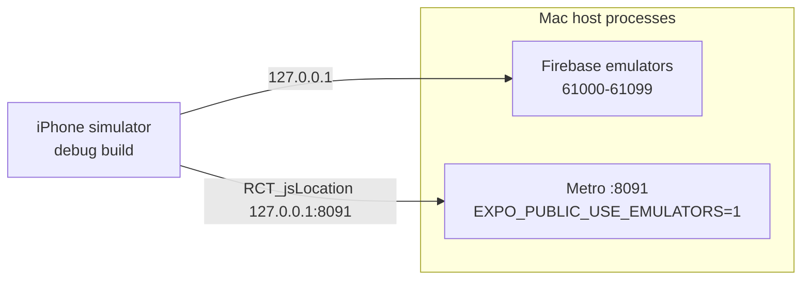
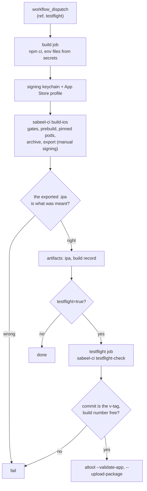

# iOS — building and checking the iPhone app

The app is one Expo codebase on three surfaces: web, Android and iOS. Linux
builds web and Android; **iOS builds only on a Mac**, with Xcode. The project
has no Mac of its own: GitHub's macOS runners do every iOS build and run the
simulator flows, and the local sections below are for a Mac when one is used.

| | |
|---|---|
| Bundle id | `com.sabeelinstitute.timetracker`, the same as the Android package |
| Firebase | project `sabeel-institute-time-tracker`, iOS app `1:858585609550:ios:6cd3d2b2a8945c65145a1f` |
| Apple | bundle id registered with Push Notifications; App Store profile "Sabeel Time Tracker App Store CI" |
| App Store Connect | app id `6823429437`, "Sabeel Time Tracker" |

App Review decisions (no account creation in the phone app, the review account,
Sign in with Apple, privacy): `docs/STORE-RELEASE.md`.

## Two rules that destroy work silently

### 1. Never a bare `npx expo prebuild`

```bash
npx expo prebuild --platform ios      # correct
npx expo prebuild                     # deletes and regenerates app/android/
```

`prebuild` is clean by default: it deletes the native folder of every platform
it is given and writes it from Expo's template. `app/android/` is **committed
and hand-edited** (the version derivation, the notification channel in the
manifest, Sentry's Gradle hook), and nothing fails when those are lost.
`--platform ios` touches only `app/ios/`.

### 2. `app/ios/` is a build product

It is gitignored and regenerated by every build, so nothing changed in Xcode's
UI survives. Everything the iOS app needs is stated in `app/app.json` (and, for
config plugins, `app/package.json`). The pods it resolves are pinned by the
committed `app/Podfile.lock`.

## What `app/app.json` says for iOS

| Key | Value | Why |
|---|---|---|
| `platforms` | includes `ios` | |
| `ios.bundleIdentifier` | `com.sabeelinstitute.timetracker` | the Android package, and the Apple and Firebase registrations |
| `ios.buildNumber` | the versionCode, as a string (`"29001"` for 0.29.1) | Apple takes each once per version, each higher than the last; `sabeel-ci release` writes it with the version; see "Releasing" |
| `ios.supportsTablet` | `false` | phone first; no iPad layout has been checked |
| `ios.googleServicesFile` | `./GoogleService-Info.plist` | committed beside `google-services.json`: client identifiers, not secrets |
| `ios.infoPlist.CFBundleDisplayName` | `Sabeel Time Tracker` | the Android launcher's name |
| `ios.config.usesNonExemptEncryption` | `false` | answers export compliance, so builds reach testers without the questionnaire |
| `ios.privacyManifests` | what the app collects, none of it for tracking | Expo writes `PrivacyInfo.xcprivacy` from it; Apple refuses an upload without one |
| `@react-native-google-signin/google-signin` | registered BARE | the plugin reads `REVERSED_CLIENT_ID` out of the plist, so the URL scheme has one home |
| `@sentry/react-native` | registered BARE | `sabeel-ci build-ios` exports the org and the native project from `ci-tools.json`'s `sentry`, and the token from `app/.env.sentry-build-plugin`; given options the plugin would write them into `ios/sentry.properties` |
| `expo-notifications` | registered BARE | writes the `aps-environment` entitlement; without it no push token ever arrives |
| `expo-build-properties` | `ios.extraPods`: GoogleUtilities, RecaptchaInterop with modular headers | without them `pod install` refuses: "Swift pod AppCheckCore depends upon GoogleUtilities and RecaptchaInterop, which do not define modules" |

There is no `ios.version`: `expo.version` is the one version on every surface.
`npm run check:ios` (`sabeel-ci check-ios-config`) holds all of the above, plus
the icon (1024x1024, no alpha) and the native crash-reporting DSN in
`app/.env.local`.

### Reading back what prebuild wrote

```bash
cd app/ios
plutil -p SabeelTimeTracker/Info.plist | grep -E 'CFBundleDisplayName|CFBundleShortVersionString|CFBundleVersion|ITSAppUsesNonExemptEncryption|URLSchemes' -A2
cat SabeelTimeTracker/SabeelTimeTracker.entitlements      # aps-environment development
plutil -p SabeelTimeTracker/PrivacyInfo.xcprivacy
```

`aps-environment` is `development` in the source entitlements; the App Store
export signs with the profile's `production`, and the GitHub build asserts that
on the exported `.ipa`. After `pod install`, React Native merges the pods'
required-reason APIs into `PrivacyInfo.xcprivacy` beside the data types
`app.json` declares.

## Files a clone does not have

All gitignored, each with a copy in the vault (`docs/SECRETS.md`). Without
each, something builds and quietly does not work.

| File | What it carries | Without it |
|---|---|---|
| `app/.env.local` | `EXPO_PUBLIC_SENTRY_DSN_NATIVE`, `EXPO_PUBLIC_SENTRY_DSN_WEB` | the app ships with crash reporting off; `check:ios` stops the build |
| `app/.env.sentry-build-plugin` | `SENTRY_AUTH_TOKEN`, `IOS_TEAM_ID`, `ASC_KEY_ID`, `ASC_ISSUER_ID`, optional `ASC_KEY_PATH` | `sabeel-ci build-ios` stops: no dSYMs or source maps could be uploaded, and nothing signs automatically |
| `~/.appstoreconnect/private_keys/AuthKey_<ASC_KEY_ID>.p8` | the App Store Connect API key (NOT the APNs key) | `-allowProvisioningUpdates` cannot sign; `sabeel-ci testflight-check` cannot ask Apple |

`sabeel-ci build-ios` reads `app/.env.sentry-build-plugin` (parsed, not
sourced; a variable already in the environment wins). Never print or commit any
of these values.

## The simulator loop

On a Mac, a debug build on the simulator, against this checkout's emulators.



```bash
# 1. Emulators, left running (JDK 21 from `npx sabeel-ci jdk21`: Homebrew's
#    openjdk@21 on a Mac, where /usr/bin/java is only a stub)
npm run emulators

# 2. Metro, in emulator mode, on a port of its own
cd app
EXPO_PUBLIC_USE_EMULATORS=1 EXPO_PUBLIC_SENTRY_DSN_NATIVE= npx expo start --port 8091 --clear

# 3. Build and install (reuses the Metro above; exits 1 at the end, see below)
EXPO_PUBLIC_USE_EMULATORS=1 npx expo run:ios --device "iPhone 17 Pro" --port 8091

# 4. Point the app at that Metro, then launch through simctl
U=<simulator udid>
xcrun simctl spawn $U defaults write com.sabeelinstitute.timetracker RCT_jsLocation -string 127.0.0.1:8091
xcrun simctl terminate $U com.sabeelinstitute.timetracker; xcrun simctl launch $U com.sabeelinstitute.timetracker
```

- **Metro's port.** Whichever Metro holds 8081 (every Expo project's default)
  serves its own bundle to any debug app that asks there. Run this one
  elsewhere and pin the app to it with `RCT_jsLocation`, a user default the
  debug app reads before its compiled-in port. `EXPO_PUBLIC_SENTRY_DSN_NATIVE=`
  keeps dev errors out of the production Sentry project.
- **Never `CI=1` on a Metro you develop against.** It puts Metro in CI mode
  ("reloads are disabled"): it serves the first bundle it built forever, and a
  relaunch looks like a change that did nothing.
- **`expo run:ios` exits 1 on a build that worked**: its last act raises the
  Simulator window through AppleScript, which an ssh session may not do. Check
  the install (`xcrun simctl get_app_container $U com.sabeelinstitute.timetracker`)
  and launch through `simctl`.
- **Accounts are made on the web**, on the simulator as in production: the dev
  row on the phone goes through the same `accountExists` gate as Google sign-in
  and refuses an address with no account. Create it first with the web dev row
  (`npx expo start --web` with `EXPO_PUBLIC_USE_EMULATORS=1`), then sign in on
  the phone and promote it: `node scripts/grant-admin.mjs <email>`. The pending
  screen turns into Home by itself.
- **Restart Metro after editing.** A running Metro can serve stale modules
  (seen on a Mac reached over ssh): Fast Refresh and a relaunch both keep old
  code, and only a restart with `--clear` reliably picks up a change. Check the build stamp or
  the change itself in the screenshot before believing a result.
- **Address the simulator by UDID.** More than one simulator can be booted at
  once, and `booted` then means more than one.

### Driving it

`~/.claude/skills/expo-firebase-stack/tools/sim-ui.py` (idb): `shot`, `tapxy`
in points (screenshot pixels / 3), `swipe`, `text`. `idb ui describe-all`
can return one empty element for the app (seen on a Mac reached over ssh), and
then every step is driven by coordinates read off the previous screenshot. `text` drops keystrokes on long
strings; type short ones and check the screenshot. Tap a field before typing:
keys with nothing focused go to React Native's dev shortcuts.

### What the simulator showed (2026-10-15, iPhone 17 Pro, iOS 26.5)

- Emulator sign-in, the pending screen, and the live switch to Home when an
  admin approves.
- The notification permission prompt, raised at sign-in.
- Activities: add one.
- Add hours: the date calendar and the time wheel open in a sheet with Done
  (`DateTimeField.ios.tsx`), several wheel columns change before Done, and the
  entry saves.
- My timesheet: the entry, the total, Submit, Withdraw.
- Approvals: the queue, Review timesheet, Approve.
- Reports (the callable) and Manage users.
- Sign out; "Sign in with Google" reaches Apple's web-authentication prompt
  (the URL scheme and client id are wired) and Cancel returns quietly.
- The phone app refuses an address with no account, and creates none.
- Sign in with email: the email account signs in to an ordinary member's Home,
  a wrong password shows "That email and password do not match an account."
  with the keyboard (switched on with `sim-keyboard.m`) dropped so the message
  is visible, and the email form sits clear of the keyboard.
- Push: the iOS row through the rules, a real sandbox push from Apple, and the
  foreground banner's tap opening the week it named (see "Push on the
  simulator").

### What the simulator cannot show

- **Real Google sign-in.** It needs a production build talking to
  production Firebase; the emulator path proves everything after the token.
- **The software keyboard.** A headless simulator behaves as if a hardware
  keyboard is attached, so no keyboard rises over a field until
  `tools/sim-keyboard.m` switches that off.
- **A notification tapped from outside the app** (home-screen banner,
  Notification Center, a killed app): SpringBoard drops synthetic taps there.
  The foreground banner's tap does work, and is how the route was checked.

## Push on the simulator

An iPhone registers Apple's own device token, and the functions send it to
Apple directly (`functions/src/apns.ts`); FCM is for Android and browsers only.
An Apple-silicon simulator gets a real token from Apple's sandbox, so the whole
round trip runs against it except the tap from outside the app.

1. **The row.** Sign in on a debug build that already allows notifications (or
   tap **Enable notifications** on Home): the app writes
   `users/{uid}/pushTokens/{token}` with `platform: 'ios'` and
   `apnsEnvironment: 'development'` (a simulator carries no provisioning
   profile, so the release type decides). The row goes through the rules, which
   accept exactly that shape. An emulator build registers on an iPhone, unlike
   Android: the sandbox really delivers to it.
2. **A real push.** From the owner's machine, with the APNs key file; it needs
   the key and the device token, not a Mac:

   ```bash
   npx sabeel-ci send-test-push --apple development <token> screen=Timesheet periodKey=2026-10-04
   ```

   The key is `~/.apns/AuthKey_<APNS_KEY_ID>.p8`, or the file `APNS_KEY_FILE`
   names. It sends exactly what the functions send (it loads `apns.ts` and
   `testPush.ts` from source, and refuses fields that are no route the app
   opens).
   With the app open the banner appears at the top; tap it and the app opens the
   route, here My timesheet on the week of 4 October (verified 2026-10-15).
3. **The emulated functions send nothing.** A trigger that reaches an iPhone row
   logs `[emulator] push suppressed for 1 device(s)`: there is no APNs or FCM
   emulator, and `APNS_KEY` is a placeholder there (`ci.emulatorSecrets` in
   `ci-tools.json`, which `sabeel-ci emulators` writes into
   `functions/.secret.local`).

`npm run check:push` asks both real services whether they accept a
message from this project (a bogus token each): FCM needs Google credentials
(Application Default Credentials, or `CHECK_ACCESS_TOKEN`), Apple takes
Secret Manager's `APNS_KEY` through `gcloud`, or `APNS_KEY_FILE`.

## Building a release

```bash
npm run build:ios -- --check   # every gate, nothing built
npm run build:ios              # gates, prebuild, pinned pods, archive, export an .ipa
```

It never uploads; the workflow's TestFlight job is the one way a build reaches
Apple. The gates, in order: macOS and Xcode; no `EXPO_PUBLIC_USE_EMULATORS` in
the shell or `app/.env.local`; the store-legal version; `check:ios`;
`IOS_TEAM_ID`; in manual mode, the profile is installed, is this app's, is
unexpired and carries the keychain's Apple Distribution certificate; and
finally a throwaway binary is signed, because a locked keychain is otherwise
found twenty minutes into the archive.

**Over ssh the login keychain is locked**, and stays locked until a GUI login
unlocks it. `sabeel-ci build-ios` stops at that gate and says so. Unlock it in
the same ssh session that builds (`security unlock-keychain`, password typed at
the prompt), or build on GitHub, which signs in a keychain of its own.

## Builds on GitHub

`.github/workflows/ios.yml` builds the app on GitHub's macOS runners, which are
free for a public repo. Builds run automatically on main pushes. To build manually or upload to TestFlight:

```bash
gh workflow run ios.yml -R Sabeel-Institute/sabeel-institute-time-tracker                                   # build an .ipa
gh workflow run ios.yml -R Sabeel-Institute/sabeel-institute-time-tracker --ref vX.Y.Z -f testflight=true   # build a release, upload it
```



**build** writes the two gitignored env files from secrets, imports the
signing identity into a keychain of its own, installs the App Store profile and
runs `sabeel-ci build-ios` with manual signing. It needs no new build number. Its
artifacts, kept 14 days: the `.ipa`, and a build record (the JavaScript source
map and the `Podfile.lock` it resolved). **testflight**, only with
`testflight=true`, asks `sabeel-ci testflight-check` two questions and stops
in seconds on either: is this commit the one tagged `v<version>` on GitHub (a
published version is never reused for other code), and is the build number
free for that version on App Store Connect. Then Apple validates the `.ipa` and
it uploads.

**The pods are pinned** by `app/Podfile.lock`, which `sabeel-ci build-ios` copies into
the generated `app/ios/` before `pod install --repo-update`, on a Mac and on
GitHub alike. If the install resolves anything else, the build stops; when a
native dependency changed on purpose, on a Mac
`cp app/ios/Podfile.lock app/Podfile.lock`, commit, and build again. Its
third-party Google and Sentry pods match the LMS's pin exactly.

**Without a Mac**, a dependency update can move a pod built from `node_modules`
(the lock's `EXTERNAL SOURCES:`), since it follows its npm package. Edit its
`PODS:` version in `app/Podfile.lock` by hand to the new package version, after
diffing the old and new `.podspec` for dependency changes and carrying those
over. Pre-merge's iOS job (`sabeel-ci pods --check` on a macOS runner) fails
unless the edit matches what `pod install` resolves; only `PODS:` is compared.

| Secret | What |
|---|---|
| `IOS_DIST_P12`, `IOS_DIST_P12_PASSWORD` | the team's Apple Distribution certificate and key (shared with the LMS and Kanban), base64, and its password |
| `IOS_PROFILE` | the App Store profile "Sabeel Time Tracker App Store CI", base64 |
| `ASC_KEY_P8` | the App Store Connect API key (Admin) |
| `BUILD_ENV` | `app/.env.sentry-build-plugin`, its `NAME=value` lines only (the Android and Web release jobs read its `SENTRY_AUTH_TOKEN` too) |
| `APP_ENV_LOCAL` | `app/.env.local`, its `NAME=value` lines only |

They are secrets of the `release-build` environment, which only main and `v*`
tags may enter (`docs/GITHUB-ACTIONS.md`, Credentials and trust). Set one with
`gh secret set NAME --env release-build -R Sabeel-Institute/sabeel-institute-time-tracker < file`
(`base64 -w0 file |` for the binary ones); every source is in the vault.

Keep comment lines out of the multi-line secrets: GitHub masks a secret line by
line, so a line of `#` turns every `#` in the log into `***`. The workflow also
masks each value on its own, since a line mask does not cover a value printed
by itself.

**Renewal, before 16 October 2027**, when the distribution certificate and the
three apps' App Store profiles expire. One certificate signs three apps, so its
secrets `IOS_DIST_P12`, `IOS_DIST_P12_PASSWORD` and `IOS_PROFILE` live in three
repos: this one, `Sabeel-Institute/lms` and `Sabeel-Institute/sabeel-institute-kanban`,
each with its own profile ("Sabeel Time Tracker App Store CI", "Sabeel LMS App
Store CI", "Sabeel Kanban App Store CI"). The key, certificate, `.p12`, its
password and the three profiles are in `~/.config/sabeel-lms/ios-distribution/`
on the Linux build machine, copied in the vault at
`~/.config/secrets-vault/sabeel/apple/ios-distribution/`.

1. A new key and signing request with `openssl`.
2. `POST /v1/certificates` (`DISTRIBUTION`), then `POST /v1/profiles`
   (`IOS_APP_STORE`) per app on the new certificate, authenticated with the App
   Store Connect API key as `sabeel-ci testflight-check` does.
3. The new key and certificate packed with `openssl pkcs12 -export -legacy`;
   the files replaced in `~/.config/sabeel-lms/ios-distribution/`, then
   `bash vault.sh collect`.
4. The three secrets set again in all three repos (each its own `IOS_PROFILE`).
5. A workflow run in each repo, then the old certificate revoked.

## Releasing to TestFlight

1. Cut the release as usual (`npx sabeel-ci release X.Y.Z --notes <entry>`,
   then `npx sabeel-ci release --ship` after the merge, from Linux;
   `docs/DEPLOY.md`). It tags `vX.Y.Z` on the commit Android and the web ship.
2. Get Faisal's go-ahead: an upload is a release.
3. Start the workflow on that tag with `testflight=true`, which `--ship` prints:
   `gh workflow run ios.yml -R Sabeel-Institute/sabeel-institute-time-tracker
   --ref vX.Y.Z -f testflight=true`, and follow it with
   `gh run watch -R Sabeel-Institute/sabeel-institute-time-tracker`.
4. Apple processes the upload before anyone can install it, typically minutes
   to an hour; App Store Connect, TestFlight lists the build when it is done.
5. The internal group **"Sabeel Time Tracker Internal"** gets every build
   automatically; nothing is added per build.

**Testers** are App Store Connect users. To add someone: invite them in App
Store Connect, Users and Access, with the Developer role; once they accept, add them to the group
(TestFlight, "Sabeel Time Tracker Internal", Testers). On the iPhone they
install Apple's TestFlight app and accept its invitation; TestFlight then
offers each new build.

**A TestFlight build expires 90 days after upload**, and the app then stops
opening on testers' phones. A release at least every 90 days keeps the iPhones
working.

**Every version uploads once, its build number its versionCode.**
`expo.ios.buildNumber` is `major * 1000000 + minor * 1000 + patch` as a string
(`"29001"` for 0.29.1), the same number as Android's versionCode, written by
`sabeel-ci release` with the version, so it rises with every version as Apple
requires. If Apple turns a build away after taking its number, cut the next
patch version: an upload is built from its release tag, so a raised build
number would need a commit the tag does not hold (`sabeel-ci testflight-check`
says the same).

## Open on iOS

- **The Google sign-in prompt names the app "SabeelTimeTracker"**: Apple's
  web-authentication alert uses `CFBundleName` (the Xcode target's name), not
  the display name.
- **The keyboard over the reject-reason field** has not been checked with
  `sim-keyboard.m`.
