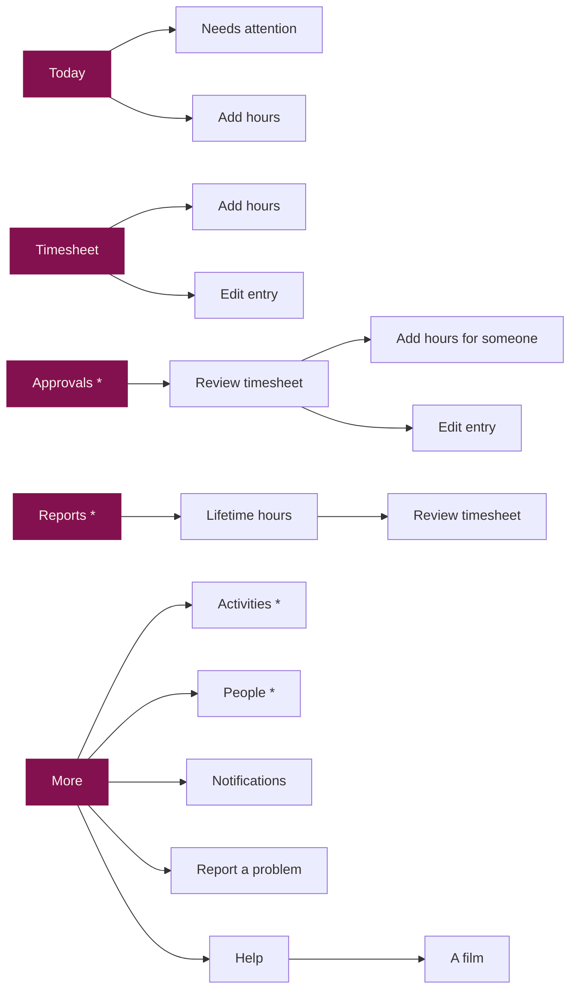

# Plan: the sibling apps' look, and help films

Status: draft for the owner's review. Nothing here is built yet. When the
work ships, this file is deleted and the current state is described in
PRODUCT_BRIEF, the manual and CLAUDE.md as usual.

## 1. Goal

Make the Time Tracker look and move like Kanban and the LMS, and give it
narrated help films like theirs. **What the app can do does not change**:
every action that exists today exists afterwards, for the same people,
with the same data and the same server.

Not in scope: new features, data-model or rules changes, Cloud Functions
changes, and any change to Kanban or the LMS.

## 2. Where the apps stand

Kanban and the LMS share one design language. The Time Tracker predates it.

| | Kanban, LMS | Time Tracker |
|---|---|---|
| Getting around | Tabs with icons: a bottom bar on a phone, a left rail on a computer; More opens a sheet | One Home screen of stacked full-width buttons, each opening a page |
| Screen top | Large title, a short line under it, icon actions at the right | Small header title; Home has its own title |
| Lists | Rows and cards from shared primitives (`ListRow`, `Card`, `SectionTitle`, `StatusChip`) | Each screen styles its own cards, chips and inputs |
| Raspberry | Primary buttons, the active tab, one key card | Also large total blocks (Reports, Lifetime hours) and many buttons |
| Switches | A themed toggle | The browser's default teal switch on the web |
| Icons | A small icon font cut by `sabeel-ci icons` | None |
| Help | Narrated films, phone and computer cuts, under More → Help | None |

What the Time Tracker already shares: the palette and its tokens (the LMS's
palette is a copy of this app's), the 700px breakpoint (Kanban's too), the
React Navigation native stack (the LMS's too), and the hex-literal lint.

## 3. Decisions

**D1. Follow the LMS's structure and primitives.** The LMS keeps React
Navigation's native stack and draws its tab bar and rail in a `Shell`
outside the navigator. That is this app's navigator already, so every
route, every `navigationRef.navigate` from a notification tap, and the
Android back button keep working unchanged. Its primitives (`Screen` with
title and actions, `Button`, `IconButton`, `Card`, `ListRow`, `NavRow`,
`RowList`, `SectionTitle`, `Chips`, `Segmented`, `StatusChip`, `Notice`,
`Field`, `SwitchRow`, `Empty`, `Sheet`, `Select`) fit this app's content
(statuses, queues, forms, people) better than Kanban's card-face set.
Kanban's hand-rolled router would mean rewriting navigation for nothing.

**D2. Copy, don't share a package.** The primitives are copied into this
app with a "Ported from the sibling LMS app" note, the convention both
siblings already use. A UI package shared by all three apps is a larger,
separate decision that would touch two apps in production; this plan
neither needs nor blocks it.

**D3. Keep this app's breakpoint (700px).** The rail replaces the bottom
bar at 700px, as in Kanban. The screen sweep reads the breakpoint from
`theme/layout.ts` and already straddles it.

**D4. Tabs by role** (the owner chose this over one Team tab holding
Approvals, Reports, Activities and People):

| Who | Tabs |
|---|---|
| Everyone | **Today**, **Timesheet**, **More** |
| Managers and admins | **Today**, **Timesheet**, **Approvals** (badge: waiting on me), **Reports**, **More** |

More is a sheet, as in the siblings: an Institute section (Activities, and
People with the pending-account count, for managers and admins), then
Notifications, Help, Report a problem, Privacy policy, Sign out, and the
version line.

`*` managers and admins only, as today.

**D5. Help films follow Kanban's pipeline and hosting.** Kanban's recorder
is the newer one and its narration is the conversational style the owner
asked for. The films go on their own public Firebase Hosting site in this
project, as Kanban's do, recorded only in a made-up guide world.

**D6. One copy of the film engine.** The generic parts of the recorder
(narration with the local TTS model, the speech-recognition check, the
Playwright recording harness, ffmpeg mixing, captions, publishing) exist
twice already, in Kanban and the LMS. They move into `ci-tools` as
`sabeel-ci films …`, and this app is its first user. Each app keeps only
its catalogue, its guide world and its film scripts. Moving Kanban and the
LMS onto it is a follow-up, done when each next re-records (the LMS's
films are due a rewrite anyway).

**D7. The rules wording moves with Report a problem.** The rules say
Report a problem is "on Home"; they will say "in More", as Kanban's do.
`RULES_VERSION` stays 1: where the button sits is not a change to the
rules, so nobody is asked to accept them again.

**D8. Route names stay.** Display titles change ("Home" shows as Today);
the route names in `nav.ts` do not, so notification routing, its tests
and the screen-sweep baselines keep their keys.

## 4. Where everything goes

Every control on today's Home, and its new place:

| Today | After |
|---|---|
| "Sabeel Time Tracker" title, greeting, "Today: 6h 30m" | Today tab: title **Today**, line under it "Salaam, *name* · 6h 30m today" |
| Red "a timesheet was rejected" banner | Today, as an error `Notice`; still opens Needs attention |
| Enable-notifications nudge | Today, unchanged behaviour |
| "This week · dates · status" strip | Today, a row with a status chip; opens the Timesheet tab |
| Clock in (activity picker) / Clocked in card / locked week card | Today, restyled; the clocked-in card stays the one raspberry card |
| Add hours manually | Today, **Add hours** button; also a + action on the Timesheet tab |
| My timesheet | Timesheet tab |
| My timesheet approver picker | Timesheet tab, beside Submit, which is what needs it |
| Approvals (n) | Approvals tab with its count badge |
| Reports | Reports tab |
| Activities | More → Activities |
| Manage users (n) | More → People (n); a dot on More while accounts wait (admins) |
| Notification settings | More → Notifications |
| Report a problem | More → Report a problem |
| Sign out | More → Sign out |
| Privacy policy link | More → Privacy policy, and the sign-in screen as now |
| | More → Help (new) |

Screens that are already pages keep their place and controls; they get
the new look. The gates (sign-in, setting up, pending, disabled, rules,
update needed, the error screen) show no tabs.

**The active tab** is the tab whose screen is at the bottom of the stack,
since Add hours, Edit entry and Review timesheet are reached from more than
one tab. A notification tap resets the stack to the tab's screen plus the
target (a submitted timesheet opens as Approvals → Review timesheet), so
both the highlight and Back are right. A tap that lands on the screen
already open re-anchors it, as now.

## 5. The screens

The rules for all of them: ivory chrome, raspberry only for a primary
action, the active tab and the clocked-in card; text in the text tokens;
true taupe only for text that carries no information; 44pt targets.

- **Today.** Title and greeting line; the rejected notice; the nudge; the
  clock card (activity `Select` and **Clock in**, or the clocked-in card
  with **Clock out**, or the locked-week card); the this-week row; **Add
  hours**.
- **Timesheet.** Month stepper with icon buttons; week chips with their
  status dots and the legend; the week's `StatusChip` and total; entries
  grouped by day under section titles, overlaps flagged as now; the
  approver `Select`; the status's action (Submit, Withdraw, Resubmit,
  Reopen for admins, Copy last week's hours on an empty draft).
- **Add hours / Edit entry.** `Field`s for activity, date (with Today and
  Yesterday), from, to and notes; the duration echo; Save, and Delete on
  edit. "Adding hours for *name*" when for someone else, still in their
  timezone.
- **Needs attention.** Rejected weeks as rows with the reason; opens the
  week.
- **Approvals.** For admins, a `Segmented` "Assigned to me / All
  submitted"; rows with name, week, submitted date and total.
- **Review timesheet.** Name as title; week stepper; status chip and
  total; the week's days with their entries; Add entry for *name*;
  Approve, and Reject with the required reason, as now.
- **Reports.** Period chips; person and activity `Select`s; the hours
  counted chips with the unapproved warning; **the total as a large number
  on a plain card, not a raspberry block**; by-activity and by-person
  rows; Export CSV. The printed statement is unchanged.
- **Lifetime hours.** The same treatment: a large number on a plain card,
  activity rows, View timesheets, Print.
- **Activities.** An add field; rows with Archive; the archived section
  with Restore and, for admins, Delete.
- **People.** The same per-person card as now (badges, approver, role,
  admin, active), built from the primitives, with the themed toggle in
  place of the teal switch; pending accounts first with Approve. Keeping
  the controls on the card keeps the admin's workflow exactly as it is.
- **Notifications, Report a problem.** Restyled; same states and copy,
  apart from the rules' "in More".
- **Help.** The film list, then a film with an "On a phone / On a
  computer" toggle that opens on the cut matching the screen.
- **Sign-in and the gates.** Already close to the siblings'; aligned to
  Kanban's sign-in card.

The two brand slips found on the way (gold-as-text on the raspberry total
cards, the teal switches) go with the screens that hold them.

## 6. Help films

Draft list, in the order the Help screen shows them:

| For | Film |
|---|---|
| Everyone | Signing in · Finding your way around · Clocking in and out · Adding hours by hand · Fixing an entry · Your timesheet · Choosing your approver and submitting · When a timesheet comes back · Notifications · Reporting a problem |
| Managers | Approving timesheets · Adding hours for someone · Reports and statements · Activities |
| Admins | Approving new accounts · Roles and access · Reopening an approved week |

Seventeen films, each in a phone cut (390×844) and a computer cut
(1440×900), with captions.

- **Catalogue**: one list in `@sabeel/shared` (`HELP_VIDEOS`), read by the
  Help screen, the recorder, the publisher and the e2e check.
- **Guide world**: made-up people, activities, and weeks in every status,
  written to the emulators. Fresh ids per world.
- **Scripts**: one entry per film; each step pairs a spoken line with what
  happens on screen. Lines are written as a colleague talking you through
  it. **The owner reads the script before any audio is rendered**, since a
  wording change after that costs a re-render.
- **The sign-in film** shows signing in with the institute Google account
  and waiting for approval, and says nothing about getting an account
  elsewhere: the phone apps must not point anyone at a sign-up.
- **Player**: `expo-video` on the phones (a new native module, so these
  builds need the next release; its pod entry is the same version as
  Kanban's), a `<video>` with captions on the web.
- **Hosting**: a new site, `sabeel-time-tracker-help`, published whole
  by `sabeel-ci films publish`, which checks every file arrived.
- **Machine**: the TTS model peaks near 12 GB, so it never runs beside an
  emulator stack or the AVD.

## 7. How this stays safe

The app has no component tests; the browser suites and the Maestro flows
are the net. So the net is strengthened first, on the current design,
and then carried across.

1. **Close the gaps first.** Today nothing exercises Copy last week's
   hours, Reopen (admin), the People role, admin and active switches and
   their confirmations, the nudge's Enable button, the email sign-in form,
   or the disabled-account screen. Each gets an e2e check against today's
   design before any visual change. When the redesign changes a screen,
   the check is updated in the same pull request, so it proves the action
   still works rather than being written to fit.
2. **One pull request per area**, each green on everything before the
   next starts: lint, types, knip, unit, emulator, `test:e2e`,
   `test:e2e:push`, `test:screens` at all five widths, and the native
   Maestro flows on Android and iOS (already required on every pull
   request).
3. **The sweep keeps its screen names** and gains the new ones (`more`,
   `help`, `help-film`), so `sabeel-ci screens-report --baseline-from-main`
   shows every pixel change against main. Its layout checks move with the
   design: the Home button-width check moves to Today's Add hours.
4. **Looking, not just passing.** Every screen at 320, 390, 700, 1024 and
   1440, signed in with real-looking data, side by side with the same kind
   of screen in Kanban and the LMS. The brand rules are checked on the
   rendered screens.
5. **Phone-only seams** on the AVD: the tab bar against the home
   indicator and keyboard, the More sheet, the film player, the back
   gesture. iOS through the simulator flows on CI.
6. **The owner tries it before anyone else.** The release candidate goes
   to a Firebase Hosting preview channel against production; the owner
   alone uses it with their own account for a few days. Staff first see
   the new design in the release. (To check: that Google sign-in accepts
   the preview channel's domain.)
7. **Rollback.** The web is rolled back by redeploying the previous
   release. Phones keep their installed build until they update; a fix is
   a new release, as always. Nothing on the server changes, so old and new
   builds work side by side.

## 8. The work, in order

| # | Pull request | Visible change |
|---|---|---|
| 0 | E2E checks for the gaps in §7.1, on the current design | none |
| 1 | Foundation: the ported primitives, a type scale, the icon font (`names.json` + `sabeel-ci icons`), the themed toggle | none yet |
| 2 | Shell: tab bar, rail, More sheet, badges, stack-reset routing; Home's buttons leave for their tabs and More; rules wording | navigation |
| 3 | Today, Timesheet, Add hours, Edit entry, Needs attention | member screens |
| 4 | Approvals, Review timesheet | approver screens |
| 5 | Reports, Lifetime hours | report screens |
| 6 | Activities, People, Notifications, Report a problem | the rest |
| 7 | Sign-in, gates, rules, update screen, error screen | gates |
| 8 | `sabeel-ci films` in ci-tools | none (tooling) |
| 9 | Help screen and player; catalogue; guide world and scripts | Help |
| 10 | Manual: navigation sections rewritten, every image regenerated by a new `manual-shots` script, the PDF; PRODUCT_BRIEF, STORE-RELEASE, DEV-TOOLING, CLAUDE.md | docs |

Between 9 and the release: the owner reviews the film scripts, the audio
is rendered and checked, the films are recorded from the release candidate
and published to the help site before the app that links to them ships.

## 9. Release

One release carries all of it, so the team relearns the app once: the
owner tries the preview, then `sabeel-ci release`, Play internal testing,
TestFlight and the web deploy, each on the owner's go-ahead as usual.
