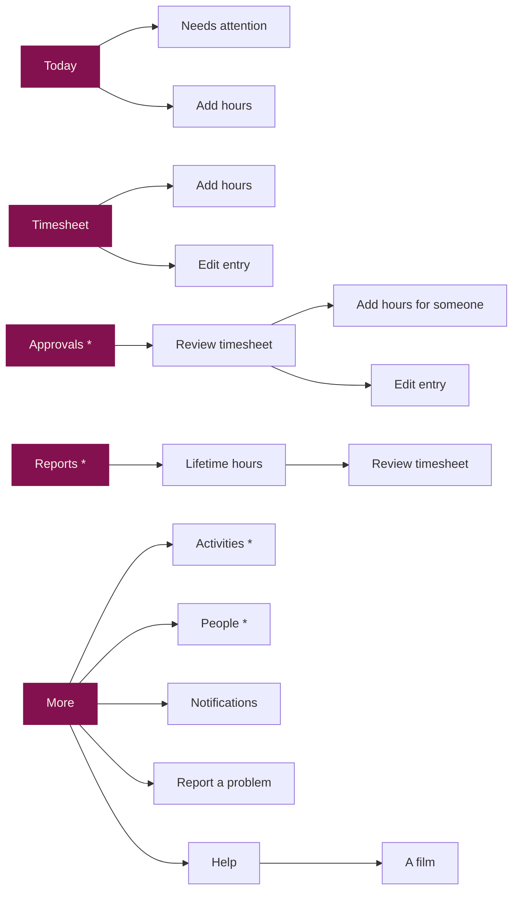

# Plan: the sibling apps' look, and help films

Status: draft for the owner's review. Nothing here is built yet. When the
work ships, this file is deleted and the current state is described in
PRODUCT_BRIEF, the manual and CLAUDE.md as usual.

## 1. Goal

Make the Time Tracker look and move like Kanban and the LMS, and give it
narrated help films like theirs. **What the app can do does not change**:
every action that exists today exists afterwards, for the same people,
with the same data and the same server.

Not in scope: new features, data-model or rules changes, Cloud Functions
changes, and any change to Kanban or the LMS.

## 2. Where the apps stand

Kanban and the LMS share one design language. The Time Tracker predates it.

| | Kanban, LMS | Time Tracker |
|---|---|---|
| Getting around | Tabs with icons: a bottom bar on a phone, a left rail on a computer; More opens a sheet | One Home screen of stacked full-width buttons, each opening a page |
| Screen top | Large title, a short line under it, icon actions at the right | Small header title; Home has its own title |
| Lists | Rows and cards from shared primitives (`ListRow`, `Card`, `SectionTitle`, `StatusChip`) | Each screen styles its own cards, chips and inputs |
| Raspberry | Primary buttons, the active tab, one key card | Also large total blocks (Reports, Lifetime hours) and many buttons |
| Switches | A themed toggle | The browser's default teal switch on the web |
| Icons | A small icon font cut by `sabeel-ci icons` | None |
| Help | Narrated films, phone and computer cuts, under More → Help | None |

What the Time Tracker already shares: the palette and its tokens (the LMS's
palette is a copy of this app's), the 700px breakpoint (Kanban's too), the
React Navigation native stack (the LMS's too), and the hex-literal lint.

## 3. Decisions

**D1. Follow the LMS's structure and primitives.** The LMS keeps React
Navigation's native stack and draws its tab bar and rail in a `Shell`
outside the navigator. That is this app's navigator already, so every
route, every `navigationRef.navigate` from a notification tap, and the
Android back button keep working unchanged. Its primitives (`Screen` with
title and actions, `Button`, `IconButton`, `Card`, `ListRow`, `NavRow`,
`RowList`, `SectionTitle`, `Chips`, `Segmented`, `StatusChip`, `Notice`,
`Field`, `SwitchRow`, `Empty`, `Sheet`, `Select`) fit this app's content
(statuses, queues, forms, people) better than Kanban's card-face set.
Kanban's hand-rolled router would mean rewriting navigation for nothing.

**D2. Copy, don't share a package.** The primitives are copied into this
app with a "Ported from the sibling LMS app" note, the convention both
siblings already use. A UI package shared by all three apps is a larger,
separate decision that would touch two apps in production; this plan
neither needs nor blocks it.

**D3. Keep this app's breakpoint (700px).** The rail replaces the bottom
bar at 700px, as in Kanban. The screen sweep reads the breakpoint from
`theme/layout.ts` and already straddles it.

**D4. Tabs by role** (the owner chose this over one Team tab holding
Approvals, Reports, Activities and People):

| Who | Tabs |
|---|---|
| Everyone | **Today**, **Timesheet**, **More** |
| Managers and admins | **Today**, **Timesheet**, **Approvals** (badge: waiting on me), **Reports**, **More** |

More is a sheet, as in the siblings: an Institute section (Activities, and
People with the pending-account count, for managers and admins), then
Notifications, Help, Report a problem, Privacy policy, Sign out, and the
version line.

`*` managers and admins only, as today.

**D5. Help films follow Kanban's pipeline and hosting.** Kanban's recorder
is the newer one and its narration is the conversational style the owner
asked for. The films go on their own public Firebase Hosting site in this
project, as Kanban's do, recorded only in a made-up guide world.

**D6. One copy of the film engine.** The generic parts of the recorder
(narration with the local TTS model, the speech-recognition check, the
Playwright recording harness, ffmpeg mixing, captions, publishing) exist
twice already, in Kanban and the LMS. They move into `ci-tools` as
`sabeel-ci films …`, and this app is its first user. Each app keeps only
its catalogue, its guide world and its film scripts. Moving Kanban and the
LMS onto it is a follow-up, done when each next re-records (the LMS's
films are due a rewrite anyway).

**D7. The rules wording moves with Report a problem.** The rules say
Report a problem is "on Home"; they will say "in More", as Kanban's do.
`RULES_VERSION` stays 1: where the button sits is not a change to the
rules, so nobody is asked to accept them again.

**D8. Route names stay.** Display titles change ("Home" shows as Today);
the route names in `nav.ts` do not, so notification routing, its tests
and the screen-sweep baselines keep their keys.

## 4. Where everything goes

Every control on today's Home, and its new place:

| Today | After |
|---|---|
| "Sabeel Time Tracker" title, greeting, "Today: 6h 30m" | Today tab: title **Today**, line under it "Salaam, *name* · 6h 30m today" |
| Red "a timesheet was rejected" banner | Today, as an error `Notice`; still opens Needs attention |
| Enable-notifications nudge | Today, unchanged behaviour |
| "This week · dates · status" strip | Today, a row with a status chip; opens the Timesheet tab |
| Clock in (activity picker) / Clocked in card / locked week card | Today, restyled; the clocked-in card stays the one raspberry card |
| Add hours manually | Today, **Add hours** button; also a + action on the Timesheet tab |
| My timesheet | Timesheet tab |
| My timesheet approver picker | Timesheet tab, beside Submit, which is what needs it |
| Approvals (n) | Approvals tab with its count badge |
| Reports | Reports tab |
| Activities | More → Activities |
| Manage users (n) | More → People (n); a dot on More while accounts wait (admins) |
| Notification settings | More → Notifications |
| Report a problem | More → Report a problem |
| Sign out | More → Sign out |
| Privacy policy link | More → Privacy policy, and the sign-in screen as now |
| | More → Help (new) |

Screens that are already pages keep their place and controls, apart from
People (§6); they get the new look. The gates (sign-in, setting up, pending, disabled, rules,
update needed, the error screen) show no tabs.

**The active tab** is the tab whose screen is at the bottom of the stack,
since Add hours, Edit entry and Review timesheet are reached from more than
one tab. A notification tap resets the stack to the tab's screen plus the
target (a submitted timesheet opens as Approvals → Review timesheet), so
both the highlight and Back are right. A tap that lands on the screen
already open re-anchors it, as now.

## 5. How it should feel

The bar is that anyone can pick up the app and do their job without being
shown. The help films are a shortcut for people who would rather watch
than tap around; if a task needs a film to be found, the screen is wrong.
Matching the siblings' parts is not enough on its own: a screen built from
the right primitives can still be a pile of boxes.

**Principles, applied to every screen:**

1. **One question, one main action.** Each screen answers one question,
   and its one raspberry button is the obvious next step: Today, "am I
   clocked in?" (Clock in or Clock out); Timesheet, "what did I log, and
   is it in?" (Submit); Review timesheet, "is this week right?"
   (Approve). Everything else on the screen is quieter.
2. **Fewer boxes.** Related rows share one surface, divided by hairlines,
   not a bordered card each. No card inside a card. A border means "you
   can tap or type here"; section titles and space do the grouping.
3. **Say what happens next.** Every empty state and every status says
   the next step in plain words ("Nothing logged this week yet. Clock in
   on Today, or add hours."). Buttons name what they do ("Submit this
   week", "Add hours for Sara"), never just "OK" or "Save".
4. **People's words, people's dates.** "Tue 13 Oct", not "2026-10-13";
   "6h 30m"; statuses as words with one colour each, used the same way on
   every screen, in the notifications and in the manual.
5. **Same thing, same place.** The title top left; Back top left; an add
   action as a + at the top right; the main action at the end of the
   content; the tabs never move.
6. **Nothing hidden.** No task needs a long-press, a swipe or a guess:
   every action is visible on the screen it belongs to. A destructive
   action asks once, in plain words, and says what will happen.
7. **The main action fits on a phone.** On a 390×844 phone, each tab's
   main action is on screen without scrolling (the sweep checks this).

**A working prototype, on the web first.** The owner judges the design
by using it, not from pictures: the branch's web build goes to a preview
site (§8.6) as soon as the tabs and the first screens exist, and again
after each round of feedback. The web is the same Expo code the phones
run, so the layout and flow settle there; the phone builds follow once the
owner is happy with it.

## 6. The screens

- **Today.** "Salaam, *name*" and today's hours at the top. Below it one
  surface holding the clock: pick an activity and Clock in, or, when
  clocked in, the raspberry clocked-in card with the activity, the time
  since and Clock out; or, when the week is already in, a line saying so.
  Then this week as one row with its status in words, opening the
  Timesheet tab; then Add hours as a quiet button. The rejected-week
  notice and the notifications nudge appear above the clock only when
  they apply.
- **Timesheet.** The week as the heading ("This week · 3–9 Nov") with
  previous and next, its status and total beside it, and a way back to
  this week when you have stepped away. The month's other weeks as a
  compact strip with their status, for jumping. Then the days, each a
  heading with its total and its entries as rows (activity, times,
  note); overlaps flagged in words. At the end, the approver and the one
  action the status allows: Submit, Withdraw, Resubmit, Copy last week's
  hours on an empty draft, or Reopen for admins.
- **Add hours / Edit entry.** One form: activity, date (Today and
  Yesterday one tap away), from and to with the duration shown as you
  type, an optional note; Save, and Delete on edit. "Adding hours for
  *name*" when for someone else, still in their timezone.
- **Needs attention.** Rejected weeks, each with the reason and who
  rejected it; tapping one opens that week to fix.
- **Approvals.** Weeks waiting for you as rows: name, week, total, when
  it came in. For admins, "Assigned to me / All submitted" above. Empty:
  "Nothing waiting for you."
- **Review timesheet.** The person's name; the week with previous and
  next; status and total; the days and entries as on the Timesheet.
  Approve as the main action; Reject asks for the reason in a sheet, so
  the reason box is not on screen until it is needed. Add hours for
  *name*.
- **Reports.** The filters in one row (period, person, activity, and
  whether to count unapproved hours), then the total as a large number,
  then by activity and by person as rows with their hours. Export CSV as
  a quiet action. The printed statement is unchanged.
- **Lifetime hours.** The large number, the activities, View timesheets
  and Print.
- **Activities.** An add field at the top; the activities as rows with
  Archive; the archived ones folded away with Restore and, for admins,
  Delete.
- **People.** A list instead of today's grid of control-laden cards:
  accounts waiting for approval first, with Approve on the row; then
  everyone else with their role in words. Tapping a person opens their
  page with approver, role, admin and active, each explained in a line
  (a new `UserEdit` route). Managers see the same list and can change a
  non-admin's approver, as now.
- **Notifications, Report a problem.** Restyled; same states and copy,
  apart from the rules' "in More".
- **Help.** The film list in three groups, then a film with an "On a
  phone / On a computer" toggle that opens on the cut matching the screen.
- **Sign-in and the gates.** Already close to the siblings'; aligned to
  Kanban's sign-in card.

The two brand slips found on the way (gold-as-text on the raspberry total
cards, the teal switches) go with the screens that hold them.

## 7. Help films

Draft list, in the order the Help screen shows them:

| For | Film |
|---|---|
| Everyone | Signing in · Finding your way around · Clocking in and out · Adding hours by hand · Fixing an entry · Your timesheet · Choosing your approver and submitting · When a timesheet comes back · Notifications · Reporting a problem |
| Managers | Approving timesheets · Adding hours for someone · Reports and statements · Activities |
| Admins | Approving new accounts · Roles and access · Reopening an approved week |

Seventeen films, each in a phone cut (390×844) and a computer cut
(1440×900), with captions.

- **Catalogue**: one list in `@sabeel/shared` (`HELP_VIDEOS`), read by the
  Help screen, the recorder, the publisher and the e2e check.
- **Guide world**: made-up people, activities, and weeks in every status,
  written to the emulators. Fresh ids per world.
- **Scripts**: one entry per film; each step pairs a spoken line with what
  happens on screen. Lines are written as a colleague talking you through
  it. **The owner reads the script before any audio is rendered**, since a
  wording change after that costs a re-render.
- **The sign-in film** shows signing in with the institute Google account
  and waiting for approval, and says nothing about getting an account
  elsewhere: the phone apps must not point anyone at a sign-up.
- **Player**: `expo-video` on the phones (a new native module, so these
  builds need the next release; its pod entry is the same version as
  Kanban's), a `<video>` with captions on the web.
- **Hosting**: a new site, `sabeel-time-tracker-help`, published whole
  by `sabeel-ci films publish`, which checks every file arrived.
- **Machine**: the TTS model peaks near 12 GB, so it never runs beside an
  emulator stack or the AVD.

## 8. How this stays safe

The app has no component tests; the browser suites and the Maestro flows
are the net. So the net is strengthened first, on the current design,
and then carried across.

1. **Close the gaps first.** Today nothing exercises Copy last week's
   hours, Reopen (admin), the People role, admin and active switches and
   their confirmations, the nudge's Enable button, the email sign-in form,
   or the disabled-account screen. Each gets an e2e check against today's
   design before any visual change. When the redesign changes a screen,
   the check is updated in the same pull request, so it proves the action
   still works rather than being written to fit.
2. **One step per area**, each green on everything before the next
   starts: lint, types, knip, unit, emulator, `test:e2e`,
   `test:e2e:push`, `test:screens` at all five widths, and the native
   Maestro flows on Android and iOS (already required on every pull
   request).
3. **The sweep keeps its screen names** and gains the new ones (`more`,
   `help`, `help-film`), so `sabeel-ci screens-report --baseline-from-main`
   shows every pixel change against main. Its layout checks move with the
   design: the Home button-width check moves to Today's Add hours.
4. **Looking, not just passing.** Every screen at 320, 390, 700, 1024 and
   1440, signed in with real-looking data, side by side with the same kind
   of screen in Kanban and the LMS. The brand rules are checked on the
   rendered screens.
5. **Phone-only seams** on the AVD: the tab bar against the home
   indicator and keyboard, the More sheet, the film player, the back
   gesture. iOS through the simulator flows on CI.
6. **The owner tries it before anyone else, from the branch.** All of
   this work stays on the `redesign` branch; nothing merges to main until
   the owner has tried it and says so. The branch's web build is deployed
   to a Firebase Hosting preview channel (`redesign`, a fixed address
   that each deploy updates), against the production database, so the
   owner signs in with their own account and sees real data. What they do
   there is real, as on the live site. The live site is untouched. Staff
   first see the new design in the release.
7. **Usable, not just working.** Besides the owner's own use: each tab's
   main action must be on screen without scrolling on a 390×844 phone
   (asserted by the sweep); every top task per role (clock in, add
   yesterday's hours, fix and resubmit a rejected week, approve a week,
   export a report, approve an account) is walked through from its tab
   with the taps counted; and a reviewer who has never seen the app is
   given only screenshots and the tasks, and says where they would tap.
   Any task they get wrong is a design bug.
8. **Rollback.** The web is rolled back by redeploying the previous
   release. Phones keep their installed build until they update; a fix is
   a new release, as always. Nothing on the server changes, so old and new
   builds work side by side.

## 9. The work, in order

All on the `redesign` branch, in this order; each step is green on every
suite in §8.2 before the next.

| # | Step | The owner sees |
|---|---|---|
| 0 | E2E checks for the gaps in §8.1, on the current design | nothing |
| 1 | Foundation: the ported primitives, a type scale, the icon font (`names.json` + `sabeel-ci icons`), the themed toggle | nothing yet |
| 2 | Shell: tab bar, rail, More sheet, badges, stack-reset routing; Home's buttons leave for their tabs and More; rules wording | |
| 3 | Today, Timesheet, Add hours, Edit entry, Needs attention | **first preview** |
| 4 | Approvals, Review timesheet | preview |
| 5 | Reports, Lifetime hours | preview |
| 6 | Activities, People, Notifications, Report a problem | preview |
| 7 | Sign-in, gates, rules, update screen, error screen | preview |
| 8 | Rounds of the owner's feedback, until they are happy with the web | previews |
| 9 | The phones: the AVD and the iOS simulator flows, the phone-only seams in §8.5 | |
| 10 | `sabeel-ci films` in ci-tools; Help screen and player; catalogue; guide world and scripts; the owner reads the scripts; films rendered, checked, recorded and published | Help |
| 11 | Manual: navigation sections rewritten, every image regenerated by a new `manual-shots` script, the PDF; PRODUCT_BRIEF, STORE-RELEASE, DEV-TOOLING, CLAUDE.md | docs |

## 10. Release

When the owner says so, the branch merges to main and one release carries
all of it, so the team relearns the app once: `sabeel-ci release`, Play
internal testing, TestFlight and the web deploy, each on the owner's
go-ahead as usual.
