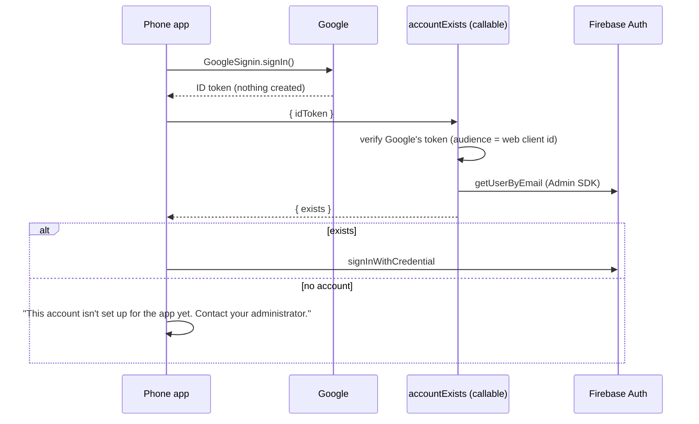

# The Time Tracker on the App Store and Google Play

This app's store record: where it stands, how it keeps the decisions every
Sabeel app shares, its answers to each store's questions, its review account
and what is left before submitting. The method and the shared decisions, with
their reasoning, are the **`sabeel-app-stores` skill**
([SKILL.md](https://github.com/Sabeel-Institute/brand/blob/main/skills/sabeel-app-stores/SKILL.md));
the sections below carry its numbers. When this file and the skill disagree on
a shared decision, the skill wins and this file is fixed. Building and shipping:
`docs/DEPLOY.md` (web, Android, Play) and `docs/IOS-BUILD.md` (iPhone,
TestFlight).

## Where it stands (2026-10-16)

| | Now | Destination |
|---|---|---|
| iPhone | TestFlight internal testing. The first build, 0.28.0 build 1 from tag `v0.28.0`, is VALID and in internal testing (2026-10-16). Internal group "Sabeel Time Tracker Internal" (Faisal; 19 staff invited to App Store Connect, added as they accept). App Store Connect app `6823429437` | The App Store, **unlisted**, after App Review. Nothing submitted; the Time Tracker follows Kanban through review |
| Android | Google Play internal testing: 0.28.0 (28000) a completed release. Play signs with the app's own key (since 2026-10-16). The "Sabeel staff" tester list is ticked; testers join through the opt-in link in the deployment guide. The GitHub release's APK is Play's own universal one, so it and a Play install update each other | Google Play **production**, a public listing (Play has no unlisted) |
| Web | Live at `https://sabeel-institute-time-tracker.web.app`, with `/privacy` and `/support` | |

## How the Time Tracker keeps the shared decisions

### 1. No account is created in the app

Both stores require in-app account deletion only from an app that creates
accounts, or (Play) points at a sign-up flow; this app does neither, so the
institute's hours are never at the mercy of a self-service delete. Faisal's
standing rule, applied here 2026-10-15.

Native Google sign-in yields Google's ID token and creates nothing;
`signInWithCredential` is the line that would. So the phone app asks first:



- **`functions/src/accountExists.ts`**: unauthenticated (there is no session
  yet); verifies Google's ID token, pinned to the web OAuth client id so a
  token minted for another client cannot be replayed; answers one boolean, and
  "no" for an unverified address. The client cannot ask instead:
  `fetchSignInMethodsForEmail` returns nothing under email enumeration
  protection.
- **`app/src/auth/google.ts`** `exchangeGoogleIdToken`: no account, no
  `signInWithCredential`, and the remembered Google account is cleared so
  another can be chosen. The emulator dev sign-in goes through it too.
- **`app/src/auth/google.web.ts`**: the web creates accounts. A first Google
  sign-in there makes the Auth user; `onUserCreate`
  (`functions/src/authTrigger.ts`) deletes any that is not a verified
  `@oursabeel.com` address and makes the rest pending for an admin.
- **The refusal names no website** (`NO_ACCOUNT_MESSAGE`,
  `app/src/auth/signInMessage.ts`). "Sign in on the website first" lives out of
  band: the user manual (1.1) and `/support`, which nothing in the app links to.
- Status does not matter, only existence: a pending or disabled account signs
  in to its gate screen, and creates nothing.

Proved by `functions/test/integration/accountExists.integration.test.ts` (each
"no" also counts the Auth users afterwards), `app/src/auth/googleGate.test.ts`
(`signInWithCredential` is never called without an account; shown red with the
exchange moved ahead of the question) and `app/src/auth/signInMessage.test.ts`.
Seen on the iPhone simulator with an emulator build (2026-10-15): an unknown
address refused, the Auth user count unchanged. **Not yet verified: the
production round trip on a phone** (see "Before submitting").

`accountExists` was deployed before the first build that calls it
(2026-10-15); a later callable an app build depends on goes live the same way
(`docs/DEPLOY.md`, runbook step 0b). APKs older than 0.28.0 predate the gate:
on a first native sign-in they still make an account (pending, or deleted if
not `@oursabeel.com`) until they are replaced, which takes an uninstall (8).

### 2. Sign in with Apple is not required

Guideline 4.8's education/enterprise exemption: Google sign-in is accepted only
for the institute's own Workspace accounts (`onUserCreate`), each approved by
an admin. The email account (3) is first-party, made by the institute.

### 3. Review access

A reviewer cannot pass Google's sign-in checks for a Workspace account, so the
reviewer gets one ordinary member account through an email door. Decided by
Faisal, 2026-10-15 (relayed by the LMS session), in three steps:

- *"sign in thru email should never be able to be an admin or manager. Just a
  member. No need for special data for it."*
- *"That way there's no special code for app reviewer."* The account is made
  and approved the ordinary way, with no script or seed, and its timesheets go
  to Faisal: *"assign me as the timesheet manager for them."*
- *"That sign in with password for kanban and timesheet should only accept that
  one email. The sign in page shouldn't indicate its a special thing for a
  reviewer."*

**What exists.** A plain **Sign in with email** link under the Google button:
email, password, Sign in. No sign-up, no password reset, nothing about
reviewers. Behind it one account, `apps-reviewer@oursabeel.com`
(`PASSWORD_ACCOUNT_EMAIL` in `@sabeel/shared`), an ordinary member whose
approver is Faisal, held there by the server:

| Lock | Where | Proved by |
|---|---|---|
| Every password **sign-up** through the public API is refused before an account exists | `beforeSignUp` (`functions/src/signInGate.ts`); the project is on Identity Platform | `functions/test/gate/signInGate.gate.test.ts` (raw REST `accounts:signUp` against the Auth emulator), `functions/test/unit/signInGate.test.ts` |
| A password **sign-in** for any other address is refused | `beforeSignIn` | the same, with a second password account the Admin SDK made |
| A password session for any other address is signed out; a password session is never a manager or admin, whatever its claims | `firestore.rules` (`isSignedIn`, `isManager`, `isAdmin`), `functions/src/auth.ts` | `functions/test/integration/rules.passwordSession.test.ts`, `functions/test/unit/auth.unit.test.ts` |
| A password-only account cannot be promoted | `setUserAccess` (`functions/src/users.ts`) | `functions/test/integration/users.integration.test.ts` |

Each denial test was shown red with its lock removed. The account sees its own
hours and timesheets and nothing else.

**The address is public, on purpose** (decided 2026-10-15): it is in this repo
and in the rules as a literal. Its protection is a long generated password and
Firebase's rate limiting, and it can see nothing but its own hours.

**How it was made** (2026-10-15), in this order on production: the blocking
functions deployed (they register with Identity Platform on deploy), then
Email/Password enabled, so the provider was never open without the gate. Then:

1. Created with the Admin SDK: `createUser` with the address, a long generated
   password and `emailVerified: true`. Not the console's "Add user", which makes
   an unverified account that `onUserCreate` deletes. The Admin SDK is not seen
   by the sign-up gate, which is the point of the gate.
2. `onUserCreate` provisioned it pending.
3. Approved as a **member** on the Users screen, approver Faisal.

**The password** is in `~/.config/sabeel-review/time-tracker-app-review.txt` on
the Linux build machine, copied in the vault at
`~/.config/secrets-vault/sabeel/review/time-tracker-app-review.txt`; at
submission it goes into App Store Connect's App Review Information **sign-in
fields** and Play Console's **App access**. Never into the review notes text,
this repo, a chat or a log.

**Resetting it:** the Admin SDK's `updateUser(uid, { password })` with a new
long generated password, reaching the project as `scripts/grant-admin.mjs`
does (Application Default Credentials, `GCLOUD_PROJECT=sabeel-institute-time-tracker`),
without printing it; the new value into the file above, `bash vault.sh
collect`; then App Store Connect's sign-in fields and Play's App access.

**No sample data.** The reviewer adds hours (Home, Add hours manually, or Clock
in), sees its week (My timesheet) and submits it. The account does not expire
and nothing in it ages. Before each submission: it signs in, and its approver
is still Faisal (an approver pointer drops when its holder loses the manager
or admin role).

### 4. What users post

| Content | Who writes it | Who sees it |
|---|---|---|
| Hours, with an optional note | each member, for themselves (managers may correct) | the member, managers, admins |
| Activity names | managers and admins | every active user |
| Rejection reasons | the approver | the member, the approver, managers, admins |
| Weekly timesheet submissions | each member | the member, their approver, managers, admins |
| Reports (Report a problem) | each member | the administrators, by email; nobody in the app |

Both stores count this as user-generated content. As the skill decides
(2026-10-16), the app has the institute's rules and Report a problem, **built
2026-10-16** (branch `rules-and-report`); they reach people with the first
release after it, the functions deployed first (`docs/DEPLOY.md`).

1. **The institute's rules, accepted once.** `app/src/screens/RulesScreen.tsx`,
   the skill's text with "Sabeel Time Tracker is for Sabeel Institute's staff
   and volunteers, and what you post is seen only by members of your team" and
   Report a problem "on Home"; **I agree** and **Sign out**; no minimum age.
   `App.tsx` shows it to an active account whose profile lacks the current
   `RULES_VERSION` (`hasAcceptedRules` in `@sabeel/shared`), after the pending
   gate and INSTEAD of the navigator, so nothing that posts is reachable and a
   tapped notification waits for it. **I agree** calls `acceptRules`
   (`functions/src/acceptRules.ts`), which writes `rulesVersion` and
   `rulesAcceptedAt` (the server's clock) on the caller's own profile, active
   accounts only; `firestore.rules` keep both fields out of every client
   write. Once per account, on every device; raising `RULES_VERSION` asks
   everyone again. Existing accounts, the review account included, see it once
   on their next open.
2. **Report a problem**, on Home beside Notification settings (the app has no
   More tab): one field, "What or who are you reporting, and what is wrong?",
   and **Send**; the draft survives Back. `reportProblem`
   (`functions/src/reportProblem.ts`) takes an active account only (a password
   session as the ordinary member it is), 1 to 2000 characters, at most five
   an hour counted from the stored reports in the same transaction as the
   write. It keeps `reports/{id}` (app, uid, name, email, role, text, time,
   platform, version, and the email's outcome), which no client reads or
   writes, then emails it from `apps-noreply@oursabeel.com` to
   `apps-reports@oursabeel.com` with Reply-To the reporter
   (`functions/src/reportMail.ts`). The send is keyless domain-wide delegation
   (`functions/src/gmail.ts`): the function's own identity has IAM sign a JWT
   as `report-mailer@sabeel-institute-time-tracker.iam.gserviceaccount.com`
   with subject `apps-noreply@` and scope `gmail.send`, exchanges it for a
   token, and Gmail sends. A failed send keeps the report, marked `failed`
   with Google's reason, and tells the person "Your report was saved but the
   email did not go out; it will be looked at."; nothing retries. The admins
   answer within 24 hours by removing the content or disabling the account.

| Promise | Proved by |
|---|---|
| A signed-out, pending or disabled caller, or a password session for another address, stores and sends nothing | `functions/test/integration/reportProblem.integration.test.ts` |
| An active caller's report is stored once and emailed once, to `apps-reports@`, Reply-To them; the review account reports as a member | the same |
| The sixth report in an hour is refused, nothing stored or sent; older reports and other people's do not count | the same |
| A failed send keeps the report as `failed` with Google's reason; the real send path, against a local stand-in for Google's three endpoints, records Gmail's id | the same, and `functions/test/unit/gmail.test.ts` |
| The email: From, To, Reply-To, Subject, RFC 2047 names, the body, no header injection | `functions/test/unit/reportMail.test.ts` |
| No client reads or writes a report, or marks the rules accepted | `functions/test/integration/rules.reports.test.ts` |
| `acceptRules` records once; a pending or disabled account records nothing | `functions/test/integration/acceptRules.integration.test.ts` |
| The rules stand before Home and before a notification's screen; after I agree, never again (reload, signing out and in); the draft survives Back; Send stores one report and clears the field | `scripts/web-e2e.mjs` |
| Both screens at five widths; nothing to post with behind the rules | `scripts/screens-e2e.mjs` |

Shown red with the lock removed: the active check (weakened to signed-in,
both callables), the rate limit (off by one), the failed-send record (deleted
instead of kept), the per-person count, Reply-To (set to the sender), the
`reports` rule (opened), the two profile fields (added to the self-update and
the admin's allow-lists), the rules gate in `App.tsx` (the e2e and the sweep),
and the kept draft (the e2e). **Not yet verified:** a production send (it
needs the deploy and the Token Creator grant, `docs/DEPLOY.md`), and both
screens on a phone.

Deliberately not: **no blocking between members** (a member who blocked their
approver could no longer have their hours approved; an admin disabling the
account blocks an abusive user from the service: `setUserAccess` disables it
and revokes its sessions) and **no word filter or automatic removal** (only
institute-made accounts post; admins remove content).

### 5. Adults only

Staff and volunteers with `@oursabeel.com` accounts, all adults; no users
under 13, so COPPA does not apply. The privacy policy's "Children" section says
the app is not offered to children under 13. Texas SB 2420 is open
("Before submitting").

### 6. Privacy

| Page | URL | File | Linked from |
|---|---|---|---|
| Privacy policy | `https://sabeel-institute-time-tracker.web.app/privacy` | `app/public/privacy.html` | the sign-in screen (reachable before signing in, 5.1.1(i)), the bottom of Home, both store listings |
| Support | `https://sabeel-institute-time-tracker.web.app/support` | `app/public/support.html` | the App Store support URL only |

Both are static, outside the signed-in app, rewritten ahead of the SPA
catch-all in `firebase.json`. **Nothing in the app links to `/support`**: it
tells a newcomer to sign in on the website first (1).
`functions/test/unit/hostingPages.test.ts` holds the rewrites, the files, the
URLs in `@sabeel/shared`, that the policy links to nothing but mail, and that
the app never links to the support page.

The policy states what is collected: name, email and the Google profile picture
link; hours (start, stop, activity, optional note, time zone); weekly
timesheets with who approved or returned them and why; a notification address
per device and notification settings; that and when the institute's rules
were accepted; reports sent with Report a problem, whose text, name and email
address are emailed to the institute's administrators; crash diagnostics
carrying only the account id. Third parties: Google (sign-in), Google Cloud and
Firebase (hosting, data in the US, Android and browser notifications), Apple
(iPhone notifications), Google Workspace (the email that carries a report),
Sentry (crash diagnostics). No advertising, no tracking, no
sale. Hours and timesheets are kept as the institute's records; the account and
personal data are removed on request to **privacy@oursabeel.com**, within 30
days.

### 8. Play signs with the app's own key

Since 2026-10-16: Play's Google-generated key replaced with the app's release
key (App integrity, App signing, Change key, Export and upload a key from Java
keystore, PEPK). A Play install and the GitHub release's APK, which is Play's
own, update each other.
`sabeel-ci publish-play` completes a release only when the APKs Play
generated carry that certificate; the earlier 0.27.1 (27001) bundle, processed
before the change, stays unreleased. APKs older than 0.28.0 are debug-signed:
a phone with one uninstalls it once before installing a release-signed build;
nothing is lost.

### 9. Distribution

- **iPhone now:** TestFlight, internal group "Sabeel Time Tracker Internal",
  which gets every build. Staff are invited to App Store Connect (Developer
  role), accept, and are added to the group (`docs/IOS-BUILD.md`).
- **Android now:** Play internal testing, the account-wide "Sabeel staff" list
  ticked on the app's Internal testing → Testers page; testers join through
  that page's link (Play sends no email) (`docs/DEPLOY.md`, "Play testers").
  Also the universal APK on each GitHub release, which Play generated from the
  same bundle.
- **Destination:** the App Store, unlisted, after Kanban is through review; and
  Google Play production, a public listing, which Play reviews in full.

### 10. Small things each store checks

- **Export compliance:** `expo.ios.config.usesNonExemptEncryption: false`
  (HTTPS only), so builds reach testers without the questionnaire.
- **Privacy manifest:** `expo.ios.privacyManifests`: `NSPrivacyTracking` false,
  no tracking domains, UserDefaults reason `CA92.1`, and five collected types
  (email address, name, user ID, other user content, crash data), all linked,
  none tracking, purpose App Functionality. `npm run check:ios` refuses a
  manifest that is missing, declares no types, or tracks.
- **Purpose strings:** none needed; the app asks for no camera, photos,
  location, contacts or microphone.
- **Xcode 26 and the iOS 26 SDK:** `ios.yml` runs on `macos-26`.
- **Play target API 36**, from React Native's Gradle defaults.

## Store answers

Each must agree with the privacy policy and the privacy manifest.

**Apple App Privacy**

| Question | Answer |
|---|---|
| Do you or your third-party partners collect data from this app? | Yes |
| Contact Info | **Name**, **Email Address**: App Functionality; linked; not tracking |
| User Content | **Other User Content** (hours, notes, timesheets, reports sent with Report a problem): App Functionality; linked; not tracking |
| Identifiers | **User ID**: App Functionality; linked; not tracking |
| Diagnostics | **Crash Data**: App Functionality; linked (Sentry carries the account id); not tracking |
| Everything else | Not collected |
| Used to track you | Nothing |

Two judgement calls: the Google profile picture **link** is stored and never
shown, so it is not declared as Photos; the device push token is a delivery
address for the app's own notifications, not a Device ID.

**Apple age rating:** user-generated content **Yes**; messaging and chat **Yes**
(rejection reasons are written feedback from an approver to a member); social
media No; advertising No; every content category None; unrestricted web access
No. Keep the rating Apple calculates (expected 4+).

**Play Data safety**

| Question | Answer |
|---|---|
| Account creation | **No** (1), so the deletion questions fall away |
| Personal info | Name, Email address, User IDs: collected, not shared, App functionality |
| App activity | Other user-generated content (hours, notes, timesheets, reports): collected, not shared, App functionality |
| App info and performance | Crash logs, Diagnostics: collected, not shared, App functionality |
| Device or other IDs | Not declared (the push token, as on Apple); if Play's SDK index lists Firebase Messaging for it, declare it, App functionality |
| Encrypted in transit | Yes |
| Deletion | By request, to `privacy@oursabeel.com` |

**Play content rating (IARC):** a productivity app; users interact **Yes**
(an "Users Interact" notice, not a higher age); no violence, sexuality,
language, controlled substances, gambling or purchases; shares location No.

**Play target audience:** 18 and over only. **Ads:** none.

**Play App access:** sign-in required. Instructions: "On the sign-in screen tap
'Sign in with email' and use these credentials", with `apps-reviewer@oursabeel.com`
and the password from the vault (3).

## Review notes

For App Store Connect's App Review Information notes and, adapted, Play's App
access instructions. Credentials go in the sign-in fields, never here. The 1.2
paragraph is true of a build with the rules screen and Report a problem (4),
the first release after 2026-10-16.

```text
This app is for the staff and volunteers of Sabeel Institute, a nonprofit
adult-education institute, to record the hours they work and submit them
weekly for approval. Accounts are provisioned by the institute through its web
application; the app refuses any identity that does not already have an
account, and no account is created from the app. Guideline 5.1.1(v) is
therefore not engaged.

Staff sign in with the institute's Google Workspace accounts (the
education/enterprise exemption under Guideline 4.8).

For review, tap "Sign in with email" on the sign-in screen and use the account
in the sign-in information (apps-reviewer@oursabeel.com). It is an ordinary member
account made by an administrator: it records its own hours (Home > Add hours
manually, or Clock in), sees its week (My timesheet) and submits it for
approval (My timesheet > Submit). Approving timesheets, managing activities,
reports and user administration belong to manager and administrator roles,
which are granted only to the institute's own Workspace accounts.

What a member records is visible only to them, to the colleague who approves
their timesheets, and to the institute's managers and administrators. Nothing
is public, searchable or discoverable, and users cannot contact strangers.
Guideline 1.2:
- Terms: every user accepts the institute's rules, which prohibit
  objectionable content and abusive users, before they can post.
- Reporting: Home > Report a problem. The report goes to the institute's
  administrators, who act on it within 24 hours by removing the content and
  disabling the author's account.
- Blocking abusive users from the service: administrators disable the
  account, which signs it out and stops it signing in. Blocking between
  members is not offered because the app carries required work: a member who
  blocked their approver could no longer have their hours approved.
- Contact: https://sabeel-institute-time-tracker.web.app/support

Account deletion is requested by email; the privacy policy (linked on the
sign-in screen) states the address, the process and what is retained. The
hours and timesheets people record are retained as the institute's records.
```

## Before submitting

**App Store** (App Store Connect, app `6823429437`)

- [x] The rules screen and Report a problem (4): built 2026-10-16; they ship
      with the next release, its functions deployed first and the Token
      Creator grant made (`docs/DEPLOY.md`).
- [ ] The production native sign-in round trip on a phone (a Play or
      download-page APK, or TestFlight): a Google account with no account in
      the project is refused and no Auth user appears; then an
      `@oursabeel.com` account signs in. Not done.
- [ ] App Privacy, as above. Not entered.
- [ ] Age rating, as above. Not entered.
- [ ] Listing: description, keywords, category, support URL and privacy policy
      URL (6), screenshots at the required sizes. Not started.
- [ ] App Review Information: contact, sign-in required, the review account in
      the sign-in fields (3), the notes above. Not entered.
- [ ] Version release: manual.
- [ ] Submit after Kanban is through review; then the Account Holder files
      Apple's unlisted request (the app submitted, not a beta).

**Google Play production** (Play Console)

- [x] The rules screen and Report a problem (4), as above.
- [ ] App content: privacy policy URL, App access, ads, content rating, target
      audience, Data safety, as above. Not entered.
- [ ] Store listing: short and full description, icon, feature graphic, phone
      screenshots, category, contact email. Not started.
- [ ] A production release, which Play reviews. The publishing service account
      has "Release apps to testing tracks" only, so the release is promoted in
      Play Console (or the account given production).

**Both**

- [ ] Confirm `privacy@oursabeel.com` exists (a Workspace group, two admins).
- [ ] Texas SB 2420 (5): a question for a lawyer before the first public
      listing, which Play production is.
- [x] `/privacy` and `/support` live; the privacy link on the sign-in screen
      and Home.
- [x] The review account made and approved (3); the sign-in gate live.
- [x] Export compliance and the privacy manifest (10).
- [x] Play signs with the app's own key (8).

## Open

- **Google's sign-in alert names the app "SabeelTimeTracker"**: Apple's
  web-authentication prompt uses `CFBundleName` (the Xcode target's name), not
  the display name. Faisal to choose a short name.
- The store listing copy, screenshots and category (both stores).
