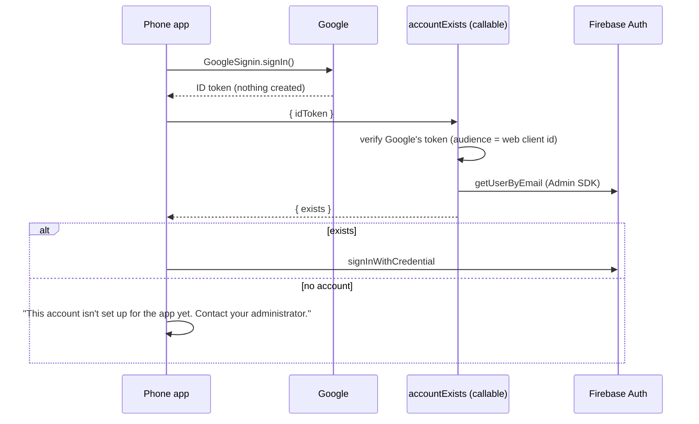

# Store release: what the stores require, and how this app meets it

The decisions behind putting the Time Tracker through Apple's App Review (and,
when it comes, Google Play): no account creation in the phone apps, the privacy
policy, how a reviewer signs in, Sign in with Apple, export compliance, the
privacy manifest and the App Privacy answers. The iPhone build itself is `docs/IOS-BUILD.md`.

The shape is shared with the sibling apps: the Kanban
(`sabeel-institute-kanban/docs/STORE-RELEASE.md`, the original statement of
this design) and the LMS. Where this file and theirs agree, theirs has the
longer argument.

## 1. The rule: the phone apps never create an account

> **The iPhone and Android apps must never cause an account to come into
> existence.** Accounts are made on the website only.

Faisal's standing rule for every Sabeel app, applied here on 2026-10-15.

**Why.** Both stores require in-app account DELETION only if the app supports
account CREATION:

- **Apple 5.1.1(v):** "If your app supports account creation, you must also
  offer account deletion within the app."
- **Google Play:** triggers if a user can create an account in the app, **or if
  the app directs the user to an account creation flow outside it.**

Satisfying neither trigger is what lets the apps ship without a deletion flow
that would have to decide what happens to the hours somebody logged, which are
the institute's records. "They already had a Google account" is no argument:
the app account is the Firebase Auth user and `users/{uid}`, which
`onUserCreate` makes the first time a Google identity signs in.

## 2. How: ask before signing in

Native Google sign-in is pure Google OAuth: it yields an ID token and touches
nothing in this Firebase project. `signInWithCredential` is the line that
creates the account. So the phone app asks first:



- **`functions/src/accountExists.ts`**: unauthenticated (there is no session
  yet), verifies GOOGLE's ID token rather than Firebase's, pinned to the web
  OAuth client id so a token minted for another client cannot be replayed, and
  answers one boolean. It cannot be done on the client:
  `fetchSignInMethodsForEmail` returns nothing under email enumeration
  protection, the default since September 2023.
- **`app/src/auth/google.ts`** `exchangeGoogleIdToken`: no account means no
  `signInWithCredential`, and the remembered Google account is cleared so
  another can be chosen. The emulator dev sign-in goes through the same
  function, so an emulator build on a phone refuses exactly as production does.
- **`app/src/auth/google.web.ts`**: the web keeps creating accounts (an unknown
  `@oursabeel.com` address lands pending, an admin approves). Nothing needs to
  detect a platform: the seam is the platform.
- **The refusal copy names no website.** "Sign in on the website first" is
  Play's second trigger almost word for word. The instruction lives out of
  band: the user manual (1.1) and the support page. One support question per
  newcomer is the price of the exemption.

**Status does not matter, only existence.** A pending or disabled account
exists, so it signs in and sees its gate screen exactly as before; signing in
to an existing account creates nothing.

## 3. What moves, and what does not

**Moves to the web:** creating an account. Nothing new had to be built there:
the web's Google sign-in already was the creation flow.

**Stays in the phone apps:** everything else, including the admin actions
(approve, roles, disable). None of them creates an identity.

## 4. Privacy and support pages

Served by Hosting as static files outside the signed-in app, because a store
crawler and a reviewer read them without signing in:

| Path | File | Linked from |
|---|---|---|
| `/privacy` | `app/public/privacy.html` | the sign-in screen (reachable before signing in, 5.1.1(i)), the bottom of Home, App Store Connect |
| `/support` | `app/public/support.html` | App Store Connect's support URL only |

`firebase.json` rewrites both ahead of the SPA catch-all.
`functions/test/unit/hostingPages.test.ts` holds the rewrites, the files, the
URLs in `@sabeel/shared` and two rules together: the policy links to nothing
but mail, and nothing in the app links to the support page, which tells a
newcomer to sign in on the website first.

The policy states what is collected, who processes it (Google, Google Cloud
and Firebase, Apple for iPhone notifications, Sentry), that hours and
timesheets are kept as the institute's records, and how to ask for deletion:
**privacy@oursabeel.com**, acted on within 30 days. That is the one address for
every Sabeel app (decided 2026-08-18).

## 5. Deploy order

The gate calls `accountExists`, so **the function must be live before any app
build that contains the gate reaches a phone**: deploy functions first, then
cut the release. A build that calls a callable that does not exist fails every
native sign-in.

1. `firebase deploy --only functions` (adds `accountExists`), and `hosting` for
   `/privacy` and `/support`.
2. Then the Android release and the first iPhone build.

Android APKs already installed (0.27.1 and older) do not call it and keep
creating an account on a first native sign-in until they update. That is the
old behaviour, not a new hole; the first release with the gate closes it.

## 6. Apple specifics

### Sign in with Apple (4.8): not required

Guideline 4.8 requires an equivalent privacy-preserving login when an app uses
a third-party login service for the user's primary account. It does not apply
where the app is used with the organisation's own account system, which is
this app: Google sign-in is accepted only for the institute's own
`@oursabeel.com` Google Workspace accounts (enforced by `onUserCreate`, which
deletes any other), and every account is approved by an administrator before
it can do anything. Workspace is the institute's account system; Google is
where it is hosted. The one email-and-password account (§ 7) is first-party,
made by the institute, so it changes nothing here. Say so in the review notes
(§ 8) rather than add Apple sign-in reflexively.

### Export compliance

`expo.ios.config.usesNonExemptEncryption: false` writes
`ITSAppUsesNonExemptEncryption = NO`. The app uses only the encryption the
operating system provides (HTTPS to Firebase, Google and Sentry), which is
exempt, so no export compliance documentation is needed and builds reach
testers without the questionnaire.

### Privacy manifest

`expo.ios.privacyManifests` (Expo writes `PrivacyInfo.xcprivacy`):
`NSPrivacyTracking` false, no tracking domains, the UserDefaults reason
`CA92.1`, and five collected types, all linked to the user, none for tracking,
purpose App Functionality: email address, name, user ID, other user content,
crash data. At `pod install` React Native merges the pods' own required-reason
APIs into the same file. `npm run check:ios` refuses a manifest that is
missing, declares no types, or tracks.

### Purpose strings

None needed: the app asks for no camera, photos, location, contacts or
microphone. The notification permission has no purpose string on iOS.

### App Privacy answers (App Store Connect)

The questionnaire must agree with the manifest and the policy.

| Question | Answer |
|---|---|
| Do you or your third-party partners collect data from this app? | Yes |
| Contact Info | **Name**, **Email Address**: App Functionality; linked to the user; not used for tracking |
| User Content | **Other User Content** (hours, notes, timesheets): App Functionality; linked; not tracking |
| Identifiers | **User ID**: App Functionality; linked; not tracking |
| Diagnostics | **Crash Data**: App Functionality; linked (Sentry carries the account id); not tracking |
| Everything else (Health, Financial, Location, Sensitive, Contacts, Browsing, Search, Purchases, Usage Data, Performance Data, Other Data) | Not collected |
| Used to track you | Nothing |

Two judgement calls, written down so they are not re-argued: the user document
stores the **link** to the Google account's avatar, which the app never shows,
so it is not declared as Photos; and the device push token is a delivery
address for the app's own notifications, not a tracking identifier, so it is
not declared as Device ID (the Kanban and LMS answer the same way).

## 7. Review access: one email-and-password member

**The problem.** A reviewer must be able to sign in (2.1). Sign-in is Google
with the institute's Workspace accounts, and a Workspace account cannot be
handed to a reviewer: Google's login challenge for a sign-in from an unusual
place goes to whoever holds the account's phone, and an administrator can lift
it for ten minutes at most. An App Review session arrives later, from somewhere
unusual, with nobody to answer.

**Decided by Faisal, 2026-10-15** (relayed by home-lms), in three steps:

- An email door for the reviewer: *"sign in thru email should never be able to
  be an admin or manager. Just a member. No need for special data for it."*
- *"That way there's no special code for app reviewer."* The account is made
  and approved the ordinary way, with no script or seed for it, and its
  timesheets go to Faisal: *"assign me as the timesheet manager for them."*
- *"That sign in with password for kanban and timesheet should only accept that
  one email. The sign in page shouldn't indicate its a special thing for a
  reviewer."*

**What exists.** The sign-in screen has a plain **Sign in with email** link
under the Google button: email, password, Sign in. No sign-up, no password
reset, and nothing that mentions reviewers. Behind it, one account,
`app-review@oursabeel.com` (`PASSWORD_ACCOUNT_EMAIL` in `@sabeel/shared`), an
ordinary member, held there by the server rather than the screen:

| Lock | Where | Proved by |
|---|---|---|
| Every password **sign-up** through the public API is refused, before an account exists | `beforeSignUp` blocking function (`functions/src/signInGate.ts`); needs Identity Platform, which the project has | `functions/test/gate/signInGate.gate.test.ts`, raw REST `accounts:signUp` against the Auth emulator |
| A password **sign-in** for any other address is refused | `beforeSignIn` blocking function | the same, with a second password account the Admin SDK made |
| A password session for any other address is signed out; a password session is never a manager or an admin, whatever its claims | `firestore.rules` (`isSignedIn`, `isManager`, `isAdmin`) and `functions/src/auth.ts` | `rules.passwordSession.test.ts`, `auth.unit.test.ts` |
| A password-only account cannot be promoted | `setUserAccess` (`functions/src/users.ts`) | `users.integration.test.ts` |

Each denial test was shown red with its lock removed. The account sees its own
hours and timesheets and nothing else (`rules.passwordSession.test.ts`).

**The address is public, on purpose** (decided 2026-10-15): it sits in this
repo and in the rules as a literal. Its protection is a long generated password
plus Firebase's rate limiting, and the account can see nothing but its own
hours, so a claim-based indirection to hide it would protect nothing.

**Making the account: ordinary admin steps, no code in this repo.**

1. Create it with the Admin SDK (`createUser` with the address, a long
   generated password and `emailVerified: true`). Not the console's "Add user":
   that makes an unverified account, which `onUserCreate` deletes as it would
   any unverified address. The Admin SDK is not seen by the sign-up gate, which
   is the point of the gate.
2. `onUserCreate` provisions it pending, like any new account.
3. Approve it as a **member** (Users screen on the web, or the same writes the
   screen makes), and set its timesheet approver to Faisal (Users screen,
   Approver).
4. The password goes into Faisal's vault and into App Store Connect's review
   notes, nowhere else.

Order on production: the blocking functions deployed (they register with
Identity Platform on deploy) **before** Email/Password is enabled, so the
provider is never open without the gate.

## 8. Review notes

The text for App Store Connect's review notes. The credentials go in App Store
Connect's sign-in fields, not in this repo.

```text
To sign in: on the sign-in screen tap "Sign in with email" and use the
credentials provided in the App Review Information. That account is an
ordinary member: it records its own hours (Home > Add hours manually, or
Clock in) and submits its week for approval (My timesheet > Submit).

This app does not support account creation. Accounts are created by the
organisation through its web application; the app refuses sign-in for any
identity that does not already have an account, and no account is created
from the app under any circumstance. Guideline 5.1.1(v) is therefore not
engaged.

Staff sign in with the organisation's own Google Workspace accounts
(@oursabeel.com) only, each approved by an administrator: the organisation's
existing account system, so Guideline 4.8 does not require Sign in with
Apple. The email sign-in is a first-party account the organisation created;
there is no third-party login on it.

Account deletion is requested by email; the privacy policy states the
address, the process and what is retained. The hours and timesheets people
record are retained as the organisation's business records.
```

## 9. What is verified, and what is not

- `accountExists`: five emulator tests, each "no" also counting the auth users
  afterwards (`functions/test/integration/accountExists.integration.test.ts`).
- The ordering: `app/src/auth/googleGate.test.ts`, the load-bearing assertion
  being that `signInWithCredential` is never called without an account; shown
  red with the exchange moved ahead of the question.
- The iPhone simulator, emulator build (2026-10-15): an unknown address is
  refused with the copy above and the auth user count does not move; once a
  web-style sign-in has created the account, the phone signs in to the pending
  screen.
- The web still creates accounts: the web suites drive sign-up through it.

**Not yet verified: the native round trip against production.** A personal
Google account with no account in the project, on a production build: refused,
and no auth record created; then a Workspace account signs in. It needs a
production build (a Release build on the simulator, or TestFlight on an iPhone)
and a person to sign in with real Google accounts. Do it before submitting for
review.
