# Sabeel Institute Time Tracker — User Manual

*For app version 0.32.2 · July 2026*

Welcome! This guide explains everything you can do in the Sabeel Institute Time
Tracker — from logging your first hour to approving your team's timesheets. It is
organized by role: **everyone** starts with Part 1; **managers/approvers** add
Part 2; **admins** add Part 3. Part 4 is a quick "How do I…?" index you can skim
any time.

The app works the same on the website
(https://sabeel-institute-time-tracker.web.app), the Android app and the iPhone
app — same account, same data, live everywhere.

**Getting the phone app.** Android: [Google Play](https://play.google.com/apps/internaltest/4701451587936876375),
by invitation from your administrator. iPhone: TestFlight, by invitation from
your administrator.

---

## The big picture (2 minutes)

1. **You log hours** against an *activity* — either by clocking in and
   out while you work, or by adding hours manually afterwards. Every hour
   belongs to a **week** (Sunday to Saturday, never crossing a month boundary —
   so the first or last week of a month can be short).
2. **At the end of the week you submit a timesheet.** That freezes the week and
   sends it to your **approver** — a manager you pick once, in the app.
3. **Your approver approves it** (it becomes official and counts in reports) or
   **rejects it with a reason** (it comes back to you to fix and resubmit).
4. **Official reports count approved timesheets only.** Until a week is
   approved, its hours exist but aren't part of the official record.

That's the whole system. Everything below is detail.

---

# Part 1 — For everyone

## 1.1 Signing in

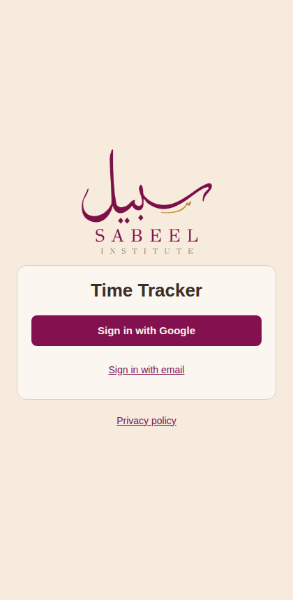

Open the app or website and tap **Sign in with Google**. Google's account
chooser appears — pick your account (or "Use another account" to switch).
There are no passwords to remember; access is entirely through your Google
account. (**Sign in with email**, under the Google button, is not for staff
accounts: always use Google.)

**The very first time, sign in on the website**
(https://sabeel-institute-time-tracker.web.app) with your `@oursabeel.com`
account. That is what creates your account. The phone apps only sign in
accounts that already exist: until you have signed in on the website once, they
say *"This account isn't set up for the app yet. Contact your administrator."*

The **Privacy policy** link under the sign-in card (and in **More**) says what
the app stores and how to ask for your account to be deleted.

### First time? You'll wait for approval

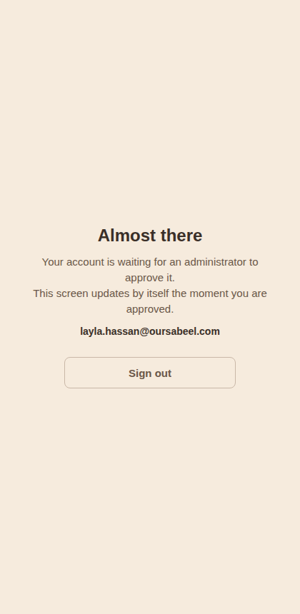

New accounts land on an **"Almost there"** screen. An administrator has to
approve your account before you can use the app — this screen updates by
itself the moment they do, no refresh needed. If you seem stuck here, contact
your admin.

The very first sign-in can show **"Setting up your account…"** for a few
seconds while the account is made. If that takes unusually long, the app says
**"Still setting up your account. Try again in a minute."**: wait a minute and
tap **Try again**. **"Can't sign in"** appears only for an address outside
`@oursabeel.com`, which the app does not accept.

### Then, once: the institute's rules

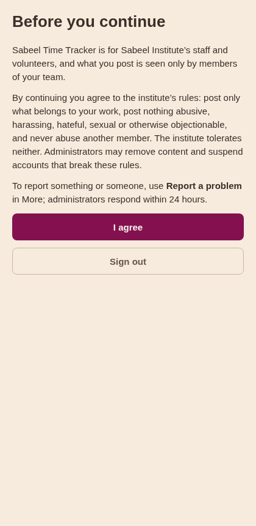

Once you are approved, the app shows the institute's rules before anything
else: what you post is seen only by members of your team, post only what
belongs to your work, and nothing abusive, harassing, hateful, sexual or
otherwise objectionable. Read them and tap **I agree**. You see them once: not
again on this device or any other, and not after signing out and in. Until you
agree, nothing else in the app opens (**Sign out** is there if you would rather
not continue).

## 1.2 Finding your way around

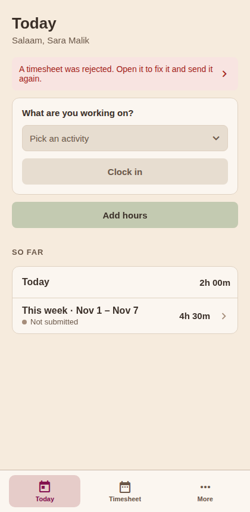

The app has **tabs**: along the bottom on a phone, down the left side on a
computer. They are on every screen, so you are never more than one tap from
where you started.

- **Today** — where the app opens: your clock, **Add hours**, and **So far**,
  your hours today and this week with the week's status (*Not submitted*,
  *Submitted*, *Approved* or *Rejected*). Tap **This week** to open it.
- **Timesheet** — your weeks, day by day, and where you submit them.
- **More** — everything else: **Notifications**, **Help**, **Report a
  problem**, the **Privacy policy** and **Sign out**, with the app's version at
  the bottom.

If a timesheet of yours was rejected, a **red notice** sits at the top of
Today — tap it to fix things (see 1.7).

Managers and admins also get **Approvals** and **Reports** tabs, and **People**
and **Activities** in More — covered in Parts 2 and 3.

Going back works as you'd expect: the arrow at the top left of a screen, your
phone's back gesture, or the browser's Back button. From any tab, Back returns
to Today.

## 1.3 Logging hours

### Clocking in and out (live tracking)

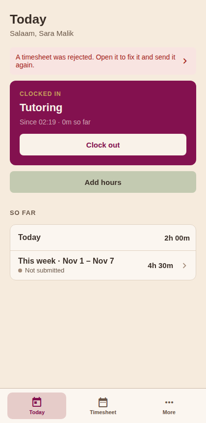

1. On **Today**, tap **Pick an activity**, search or scroll, tap one.
2. Tap **Clock in**. The raspberry card shows what you're working on and how
   long you've been at it.
3. When you finish, tap **Clock out**. The session becomes an entry, and
   **So far** counts it.

Good to know:

- You can only have **one running session** at a time.
- Forgot to clock out? Sessions are **automatically closed after 12 hours**
  and marked "closed automatically" — edit the entry afterwards to correct the
  times.
- The card reminds you once a session passes 8 hours.

### Adding hours by hand

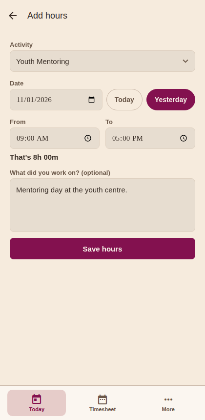

For work you didn't clock (yesterday's event, off-site work):

1. **Today → Add hours**, or the **+** at the top of **Timesheet**.
2. Pick the activity, the day (**Today** and **Yesterday** are one tap, or use
   the date box for any other day), and the from and to times.
3. Watch the **"That's 8h 00m"** line under the times — it shows the length
   you're about to save, so AM/PM slips jump out before you save.
4. Add a note if it helps your approver, then **Save hours**.

Opened from a past week on Timesheet, Add hours starts on that week's first
day, so the hours land where you were looking.

### Copying last week

If your weeks look alike: open an **empty** week on Timesheet and tap **Copy
last week's hours**. Every entry from the previous week is copied to the same
weekday and time, ready to adjust. (Only offered while the week has no entries
yet.)

## 1.4 Your timesheet week by week

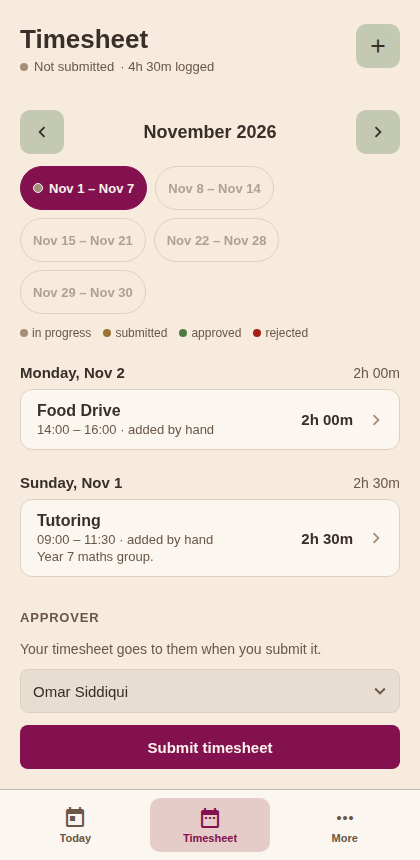

The **Timesheet** tab, top to bottom:

- **The month**, with arrows to step to the month before or after.
- **A chip for each week** of the month; tap one to open that week. The dot on
  a chip says where the week stands, and the legend under the chips says the
  same in words:
  - **taupe** — hours logged, not submitted yet (in progress)
  - **gold** — submitted, waiting for your approver
  - **green** — approved
  - **red** — rejected, waiting for you to fix it
  - **no dot** — nothing logged
- **The week's status and total**, under the title.
- **The days**, each with its total and its entries: activity, times and note.
  **Tap an entry to change or delete it** (activity, date, times, note). Times
  you leave alone stay exactly as they were clocked. On a session that ran past
  midnight, a **To** earlier than **From** is the next morning. Deleting asks
  first.
- Weeks not yet begun are dimmed. Wandered off? **Back to this week** returns
  you.

### Overlapping entries

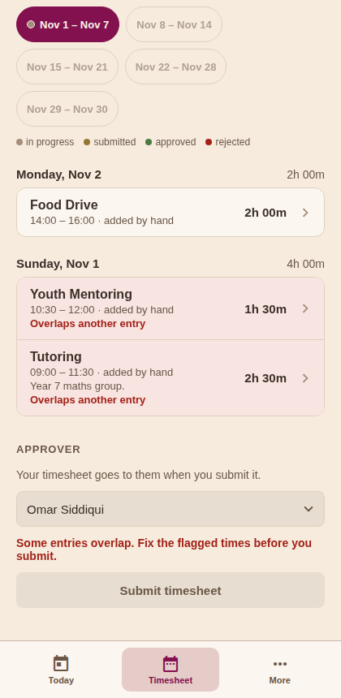

Two entries on the same day whose times overlap are **shaded red** ("Overlaps
another entry") — usually a double log or an AM/PM slip. A week with overlaps
**can't be submitted** until you fix the times. Back-to-back entries are fine:
one ending at 2:00 PM and the next starting at 2:00 PM don't overlap.

## 1.5 Choosing your approver

Before your first submission, tell the app who approves your hours: on
**Timesheet**, under **Approver** (shown on a week you can still submit), tap
the box and pick from the list of managers. It sticks — it applies to every
future submission until you change it — and changing it never affects a week
you've already submitted.

If you are a manager or an admin yourself, your own name is at the bottom of the
list as **"(myself)"** — managers and admins may approve their own hours. You
still submit first and approve after: a submitted week is locked to you like
anyone else's, so withdraw it if you need to make a change.

Until an approver is chosen, Timesheet says *"Choose who approves your hours
above, then submit."* and Submit stays unavailable.

## 1.6 Submitting your week

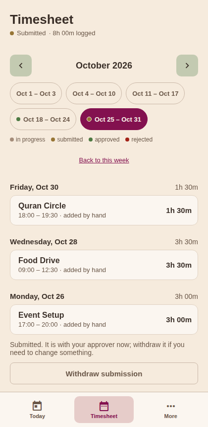

1. Open the week on **Timesheet** and give it a once-over.
2. Tap **Submit timesheet**. The status turns **Submitted** and the week
   **locks** — you can't add or change entries while your approver has it.
3. Change your mind? **Withdraw submission** unlocks it (only until it's
   approved).

Rules of thumb:

- You can submit the **current week early** (say, Friday) — but you can't log
  more hours into it afterwards without withdrawing first. If you're clocked
  in, clock out before submitting.
- **Overlapping entries block submission** (see 1.4) — fix them first.
- **Past weeks can be submitted any time, in any order.** No deadlines.
- **Empty weeks can be submitted too** ("Submit timesheet (no hours)") — useful
  to close out a week you were away.
- Weeks not yet begun can't be submitted.

## 1.7 When a timesheet is rejected

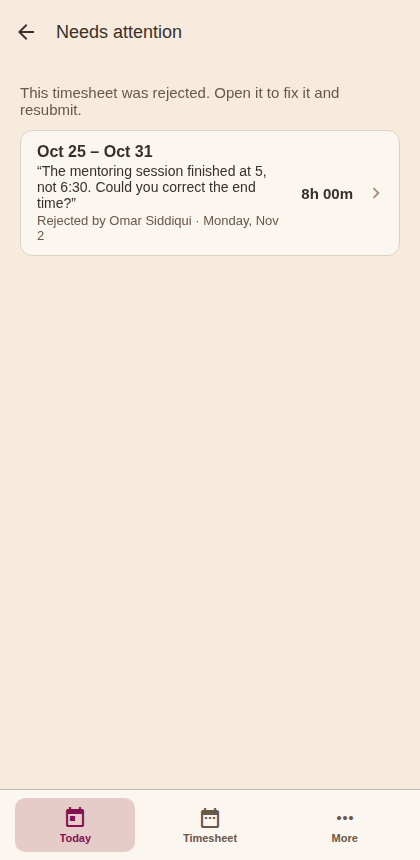

If your approver rejects a week, a **red notice appears at the top of Today**.
Tap it to open **Needs attention** — one list of every rejected week (even from
months back), each with the approver's reason, who rejected it, and when.

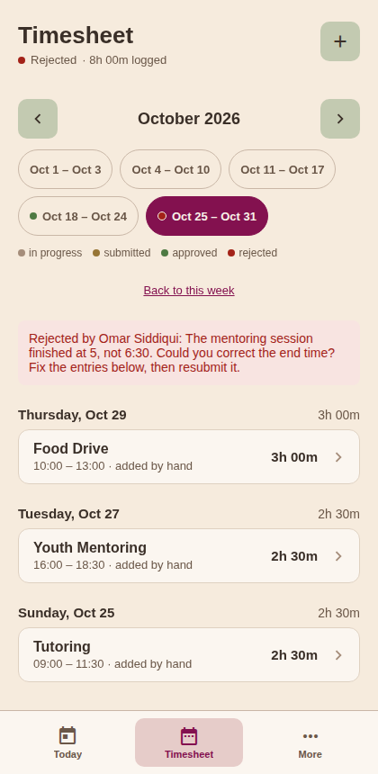

Tap a row and you land on that week on Timesheet, with the reason at the top:

1. Fix the entries the reason points at (tap to change them, add what's
   missing).
2. Tap **Resubmit timesheet**. It goes back to your approver, and the week
   leaves Needs attention.

## 1.8 After approval

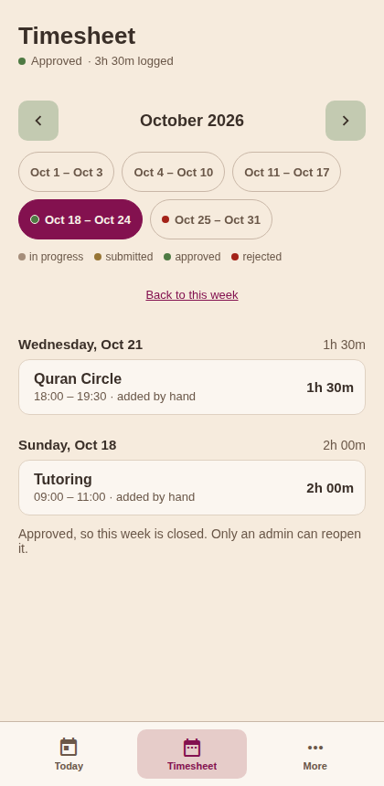

An approved week shows **Approved** and is locked for everyone — that's what
makes it official. Its entries can no longer be opened to change. Spot a
mistake after approval? Ask an **admin** to reopen the week; it returns to
draft and goes through submit and approve again.

## 1.9 Notifications

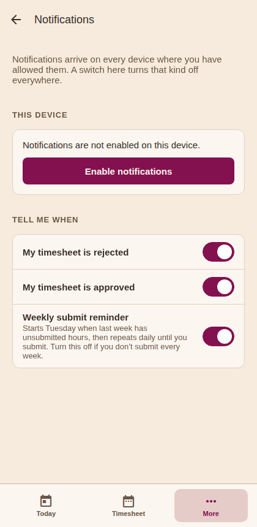

The app sends push notifications so nothing sits unnoticed:

- **Your timesheet was rejected** (with the reason) or **approved**.
- *Approvers:* someone **submitted or resubmitted** a timesheet to you.
- *Admins:* a **new account** is waiting for approval.
- A **submit reminder** — if last week has logged hours that were never
  submitted (or a rejected sheet), you get a nudge on **Tuesday morning** in
  your local timezone, and then **daily** until you submit it. Weeks with
  nothing to submit don't nag.

**Tapping a notification opens the screen it is about**, not just the app: a
decision on your timesheet opens that week on Timesheet; a submission opens that
person's week ready to review; a new account request opens People. This works
from a closed app too — the app finishes signing you in first, then goes there.
In a browser it opens in the tab you already have open, or in a new one.

Push notifications need the device's own permission. The app never asks by
itself: it offers to set it up once, with an **Enable notifications** card on
Today after you sign in — or open **More → Notifications** any time and use
**Enable notifications**. The phone's own question appears only when you tap
one of those (on an iPhone it can be asked only once, so answer **Allow**). If
they have been blocked, that button becomes **Open settings** on a phone; in a
browser, allow them from the site settings behind the icon in the address bar.
Under **Tell me when**, a switch for each kind turns it off everywhere; the
**weekly reminder has its own switch**, so people who don't submit every week
can silence the nagging and keep the important notifications on.

On Android these all arrive under one entry in the phone's own notification
settings — **Timesheet alerts and reminders**. Turning that entry off silences
every kind at once, whatever the switches inside the app say.

Notifications follow the account signed in on the device: signing out stops
this phone or browser from receiving that account's notifications.

## 1.10 Switching accounts / signing out

**More → Sign out.** Signing out fully clears your Google session in the app, so
the next sign-in always shows Google's account chooser — that's how you switch
between accounts.

## 1.11 Reporting a problem

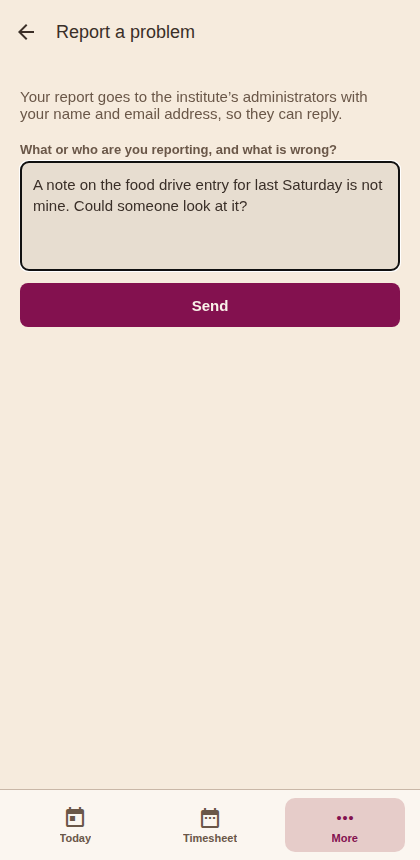

If something in the app breaks the institute's rules (a note, an entry, a
rejection reason) or someone is behaving badly, or anything else is wrong, open
**More → Report a problem**. Say what or who you are reporting and what is
wrong, in your own words: name the week, the entry or the person, so an
administrator can find it. Then tap **Send**.

- **"Sent. An administrator will reply by email within a day."** Your report
  has gone to the institute's administrators, with your name and email
  address. They reply to you by email, and act on it by correcting or removing
  the content or disabling the account.
- **"Your report was saved but the email did not go out; it will be looked
  at."** The report is kept in the app, and the administrators will see it
  there. You need not send it again.
- If you go **Back** before sending, what you typed is still there when you
  come back.
- You can send up to five reports an hour.

## 1.12 Help films

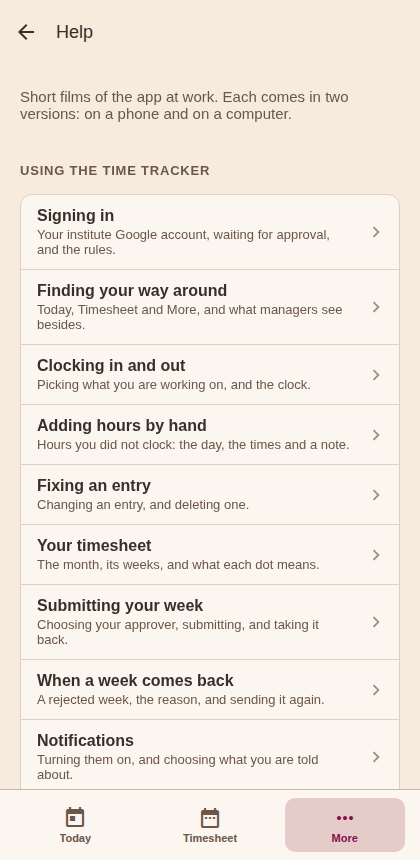

**More → Help** has short narrated films of the app at work: signing in,
clocking, adding and fixing hours, your timesheet, submitting, a rejected
week, notifications and reporting a problem, then managers' and admins' work.
Each film comes in two versions, on a phone and on a computer; it opens on the
one for the screen you're watching on, and the other is a tap away. On the
website the films have captions.

---

# Part 2 — For managers & approvers

Managers get two extra tabs, **Approvals** and **Reports**, and in **More**,
**People** (to set approvers) and **Activities**.

## 2.1 Approving timesheets

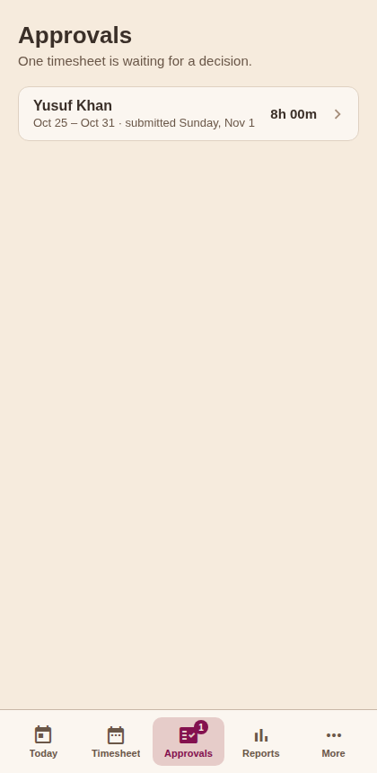

The **Approvals** tab. The number on it says how many submissions are waiting
for *you* — the sheets whose submitters picked you as their approver. Admins
also get **Assigned to me / All submitted**, to see everyone's queue.

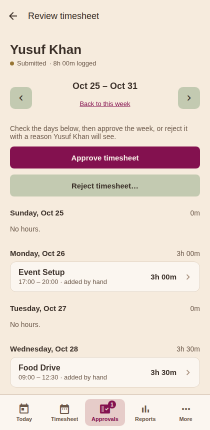

Tap a submission to review it:

- **Approve timesheet** and **Reject timesheet…** sit right under the week, with
  every day of the week below, Sunday to Saturday, empty days included — so a
  missing day is as visible as a logged one.
- **Tap any entry to correct it** (times, activity, note) — your change is
  marked "corrected" on the entry.
- **Add hours for {name}**, at the bottom, logs hours on the person's behalf
  (they forgot their Saturday setup, say). **Times are read in *their*
  timezone, not yours** — enter the hours as that person worked them; if their
  timezone differs from yours the form says so. That way an entry always means
  what the person actually did, whoever typed it in.
- Then either:
  - **Approve timesheet** — the week becomes official and locks, or
  - **Reject timesheet…** — it asks what they need to fix, then returns the
    week to them with your reason word for word. A reason is required; "fix it"
    helps nobody.

The arrows at the top step through the person's other weeks — you can review or
correct any week not yet approved, not just the submitted one.

## 2.2 Browsing someone's timesheets (before they submit)

**Reports** → tap a person under **By person** → **View timesheets**. The same
week-by-week view — handy mid-week to see how someone's week is shaping up, or
to add hours they forgot, without waiting for a submission.

## 2.3 Activities

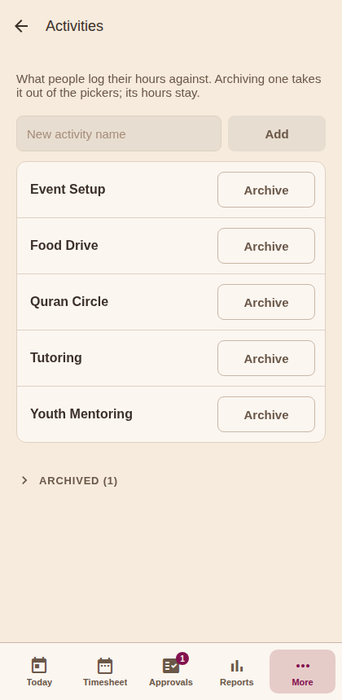

**More → Activities.** Create the activities people log hours against — a name
is all it takes, whether it's an ongoing program ("Tutoring") or a one-off event
("Food Drive").

**Archive** an activity to take it out of the pickers. Archived activities wait
at the bottom under **Archived**, closed until you open it, and keep their
history in every report. **Restore** brings one back.

An admin can also **Delete** an archived activity. It asks first, can't be
undone, and the hours already logged under it keep its name.

## 2.4 Reports & exports

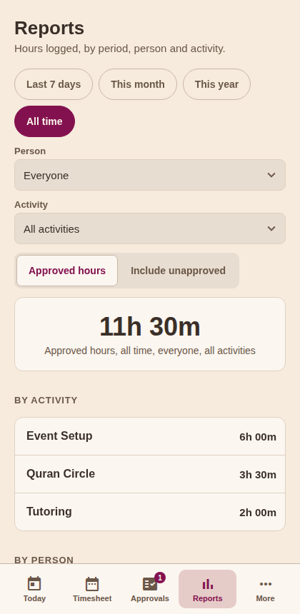

The **Reports** tab:

- **Period** — the last 7 days, this month, this year, or all time.
- **Person / Activity** — searchable filters; the default is everyone and
  everything.
- **Approved hours / Include unapproved** — the important switch:
  - **Approved hours** — the default. Only hours from *approved* timesheets.
    This is the number for the board, grants and records.
  - **Include unapproved** — adds hours still waiting for approval (marked not
    official; CSV exports get an `_unofficial` filename so nobody mistakes
    them).
- **The total**, large, with what it counts in words under it, then the hours
  **By activity** and **By person**.
- **Export CSV** — downloads the filtered entries with person, email,
  activity, date, times, timezone and hours per row.

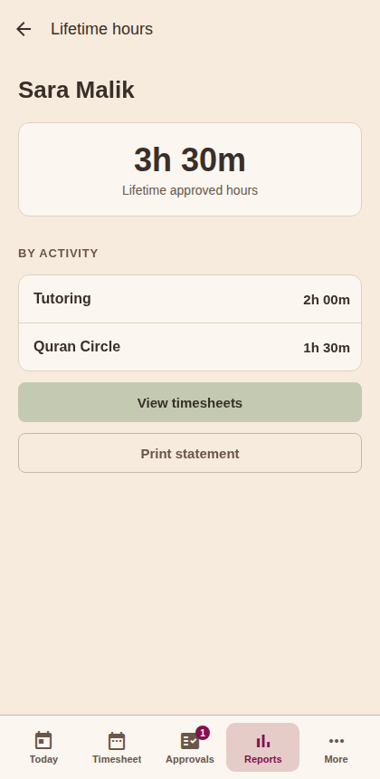

Tapping a person under **By person** opens their **Lifetime hours**: approved
hours by activity, **View timesheets**, and **Print statement** (on the
website) — a clean printable statement of their volunteer hours, for school
credit letters, say.

### A note on timezones

Every entry remembers *where* it happened. Someone working 9:00–17:00 in
Singapore shows 9:00–17:00 on the correct day for every viewer — reports never
shift hours into the viewer's timezone.

---

# Part 3 — For admins

Admins manage people: **More → People**. Admins also have Approvals, and can
approve or reject *any* submitted timesheet, including their own.

## 3.1 Approving new users

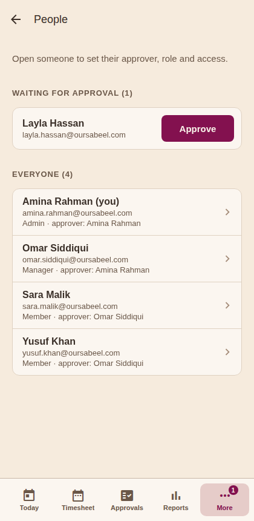

When someone signs in for the first time they appear at the top of **People**
under **Waiting for approval**, with their name and email. The **More** tab
carries a number while requests are waiting, and admins get a push
notification. Tap **Approve** and their screen unlocks live, wherever they are.

## 3.2 Managing a user

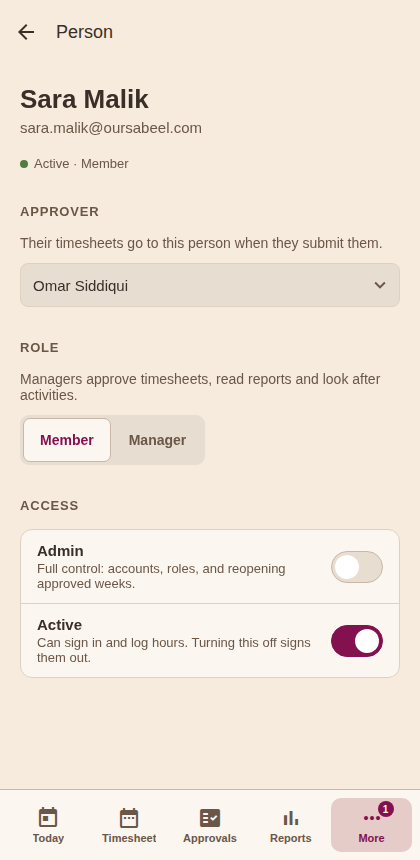

Tap someone on **People** to open their page:

- **Approver** — who approves their timesheets. Set it here, or let them pick
  their own on Timesheet. (Managers can set this for non-admins too; the rest
  of the page is admins'.) A manager or admin may be their own approver. Note
  that **changing someone's role, or disabling them, clears every approver
  pointing at them** — those people will be asked to choose a new approver
  before their next submission.
- **Role: Member | Manager** — managers get Approvals, Reports and Activities.
- **Admin** — the full-control switch (see below).
- **Active** — turn off to disable an account: they're locked out immediately
  and can't log hours. Turn back on to restore. Nothing is ever deleted.
  Disabled accounts are listed at the bottom of People under **Disabled**.

Every change asks first, so a stray tap can't promote or disable anyone. You
cannot demote, disable or un-admin **yourself** — so the institute can never
lock itself out.

**Grant admin sparingly.** As its question says: an admin can approve, disable
and manage *any* user, grant admin to others, change roles, and reopen approved
timesheets. Admin is different from manager — a manager runs the work
(activities, reports, approvals); an admin controls the people.

## 3.3 Reopening an approved timesheet

Approved weeks are locked for everyone — except that an admin can **reopen**
one: open the person's week (Reports → the person → View timesheets, or your
own on Timesheet) and tap **Reopen (admin)**. The week returns to draft; the
owner fixes it and it goes through submit and approve again. Use it for genuine
mistakes discovered after the fact.

## 3.4 Odds and ends

- **Reports from "Report a problem"** arrive by email at
  `apps-reports@oursabeel.com`, not in the app; nobody reviews them inside it.
  Each says who sent it (name, email, role), when, from which app version, and
  what they wrote. **Reply** to the email to answer them (it goes to the
  person), and act through the app's ordinary screens: correct or delete the
  entry, or disable the account (3.2), which signs them out and keeps them
  out. The rules promise a response **within 24 hours**.
- **First admin** of the system is created once during deployment; every
  further admin is granted in the app with the Admin switch.
- **Error notice**: if a red notice about live data ever appears at the top of
  a screen, the app couldn't load live data (permissions or connectivity).
  It's also reported automatically to the error dashboard — tell the developer,
  mentioning what you were doing.

---

# Part 4 — "How do I…?" quick answers

**…log the hours I worked right now?**
Today → pick the activity → Clock in → work → Clock out.

**…log yesterday's hours?**
Today → Add hours → Yesterday → set the times → Save hours.

**…fix a wrong entry?**
Timesheet → the week's chip → tap the entry → change it → Save changes.

**…delete an entry?**
Tap the entry, then **Delete entry**, and confirm.

**…submit my week?**
Timesheet → check the week → Submit timesheet. (Clock out first; choose an
approver once if you haven't.)

**…submit a week I missed a while ago?**
Timesheet → the arrow back to its month → its week's chip → Submit. Old weeks
have no deadline. Empty weeks can be submitted as "(no hours)".

**…add more hours after I submitted?**
Withdraw submission (while it's still waiting for approval) → add hours →
Submit again. If it was already approved, ask an admin to reopen it.

**…see why my timesheet was rejected, and fix it?**
Tap the red notice on Today → tap the rejected week → read the reason → fix
the entries → Resubmit timesheet.

**…change who approves my timesheets?**
Timesheet → Approver → pick someone else. Applies from your next submission.

**…sign in with a different Google account?**
More → Sign out → Sign in with Google → the account chooser appears.

**…use the phone app when it says "This account isn't set up for the app yet"?**
Sign in once on the website (https://sabeel-institute-time-tracker.web.app)
with the same account; that creates it. Then sign in on the phone.

**…report something or someone?**
More → Report a problem → say what or who, and what is wrong → Send. An
administrator replies by email within a day.

**…stop the weekly reminder without losing other notifications?**
More → Notifications → switch off **Weekly submit reminder**.

**…watch how something is done?**
More → Help → pick a film.

**…approve or reject someone's week?** *(managers)*
Approvals → tap the submission → Approve timesheet, or Reject timesheet… and
say what to fix.

**…add hours for someone who forgot?** *(managers)*
Approvals → their submission → Add hours for {name}. Or before they submit:
Reports → the person → View timesheets → Add hours for {name}.

**…create a new activity?** *(managers)*
More → Activities → type its name → Add.

**…get official hours for a grant report?** *(managers)*
Reports → set the period → keep "Approved hours" → Export CSV.

**…print a volunteer's hours statement?** *(managers, website)*
Reports → tap the person → Print statement.

**…let a new team member in?** *(admins)*
They sign in once with Google → More → People → Approve on their row.

**…make someone a manager / an admin?** *(admins)*
More → People → their name → Role: Manager, or the Admin switch → confirm.

**…disable someone who left?** *(admins)*
More → People → their name → Active off → confirm. Their history stays.

**…fix an already-approved week?** *(admins)*
Open that week → Reopen (admin) → the owner fixes it and resubmits.

---

## Troubleshooting

| What you see | What it means | What to do |
|---|---|---|
| "Update needed" when the app opens | This version of the phone app is too old to keep working | Tap **Open Google Play** (or **Open TestFlight** on an iPhone) and install the update; nothing you recorded is lost |
| "Almost there" screen after signing in | Your account awaits admin approval | Ask your admin; the screen unlocks by itself once approved |
| "Still setting up your account. Try again in a minute." | Your new account is taking longer than usual to be made | Wait a minute and tap **Try again** |
| "Can't sign in" | The address is not an `@oursabeel.com` account | Sign out and sign in with your `@oursabeel.com` Google account |
| "Before you continue" screen | The institute's rules, shown once to every account | Read them and tap **I agree** |
| "Your report was saved but the email did not go out" | The report is kept, but its email failed | Nothing: the administrators will see it; no need to send it again |
| "Choose who approves your hours above, then submit." | No approver chosen yet | Timesheet → Approver → pick one |
| "This week is submitted, so it is closed for new hours" on Today | The current week is locked | Withdraw the submission on Timesheet (or ask an admin to reopen an approved week) |
| "Clock out before you submit this week." | A session is still running | Clock out on Today, then submit |
| An entry is shaded red: "Overlaps another entry" | Two entries on that day have overlapping times | Tap one and fix its times; submission unlocks once no entries overlap |
| No push notifications arriving | Permission not granted on this device, or that kind is switched off | Allow notifications when the app asks (or in system settings), and check More → Notifications |
| A red notice about live data at the top of a screen | The app couldn't load live data | Check connectivity; if it persists, tell the developer — it's also auto-reported |
| A week's chip has a red dot | That week was rejected | Tap the red notice on Today → fix → resubmit |

*Manual source: `docs/USER-MANUAL.md` (images in `docs/manual/img/`). PDF:
`docs/USER-MANUAL.pdf`. Update both together when the app changes.*
